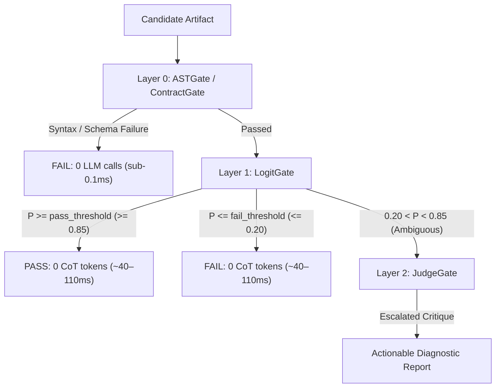

# LogitGate (`logitgate`)

[](https://pypi.org/project/logitgate/)
[](LICENSE)
[](https://www.python.org/downloads/)
[](src/logitgate/py.typed)
[](pyproject.toml)
[](https://github.com/astral-sh/ruff)
[](https://gitlab.com/jasonbdly/logitgate/-/pipelines)

**Fast, calibrated first-token logit evaluation and 3-layer cascaded routing for LLMs.**

LogitGate replaces slow, multi-token LLM-as-a-judge critiques (5–20s) with calibrated first-token logit gates (**36–110 ms**) and a 3-layer cascaded routing pipeline (`ASTGate >> LogitGate >> JudgeGate`), saving 90%–98% of evaluation tokens and wall-clock time while canceling token prior and positional biases.

---

## How It Works in 60 Seconds

When evaluating whether an LLM output satisfies a rubric, traditional frameworks prompt a model to generate a 200–500 word critique before outputting `PASS` or `FAIL`. This takes **5 to 20 seconds**, consumes hundreds of tokens, and suffers from recency and positional biases.

`LogitGate` uses a **3-layer cascaded pipeline**:



1. **Layer 0 (`ASTGate` / `ContractGate`)**: Deterministic checks in **<0.1 ms** on CPU (Python AST syntax, JSON/Pydantic schemas, regex patterns, acyclic DAG topology). Failures reject immediately with zero LLM overhead.
2. **Layer 1 (`LogitGate` / `ChoiceGate` / `ScoreGate`)**: Reads **first-token log-probabilities (`max_tokens=1`)** in **~36–41 ms on GPU** (~170 ms on CPU). To eliminate pretraining label bias, it averages forward and reverse passes in log-odds space ($\bar{L} = \frac{L_1 + L_2}{2T}$).
3. **Layer 2 (`JudgeGate`)**: Only when Layer 1 confidence is genuinely ambiguous (between 20% and 85%) or requires failure diagnostics does the pipeline escalate to generating a full text critique.

---

## Installation

```bash
# Core package (zero dependencies except pydantic & httpx)
pip install logitgate

# With optional framework integrations:
pip install "logitgate[openai]"      # OpenAI, vLLM, and compatible endpoints
pip install "logitgate[llamacpp]"    # In-process llama.cpp (zero background daemon)
pip install "logitgate[langgraph]"   # LangGraph conditional edge routing
pip install "logitgate[deepeval]"    # DeepEval System-1 metrics
pip install "logitgate[recurrent]"   # Elastic recurrent looping (NVIDIA Dory-4B)
pip install "logitgate[all]"         # All integrations
```

---

## 30-Second Quickstart

### 1. Single Atomic Rubric (3-Layer Cascaded Fast Path)

```python
from logitgate import ASTGate, LogitGate, JudgeGate

# Compose the 3-layer pipeline using the >> operator
cascade = (
    # Layer 0: Ensure valid Python syntax without LLM calls (<0.1ms)
    ASTGate(syntax=True)
    # Layer 1: First-token debiased logit gate (~40-90ms, 0 CoT tokens)
    >> LogitGate(
        rubric="Does the function calculate Fibonacci numbers using recursion?",
        pass_threshold=0.85,
        fail_threshold=0.20,
    )
    # Layer 2: Escalated diagnostic judge (only fires if Layer 1 is ambiguous or failing)
    >> JudgeGate(trigger="on_ambiguous_only")
)

candidate_code = """
def fibonacci(n: int) -> int:
    if n <= 0:
        return 0
    elif n == 1:
        return 1
    return fibonacci(n - 1) + fibonacci(n - 2)
"""

verdict = cascade.evaluate(candidate_code)

print(f"Passed: {verdict.passed}")               # True
print(f"Confidence: {verdict.probability:.4f}")   # e.g., 0.9982
print(f"Triggered Layer: {verdict.triggered_layer}")  # LogitGate (bypassed Layer 2!)
print(f"Latency: {verdict.total_latency_ms:.1f}ms")    # ~86ms
print(f"Tokens Generated: {verdict.total_tokens_generated}")  # 0 tokens!
```

### 2. Multi-Rubric Batching (Prefix-Preserved KV-Cache Reuse)

When verifying multiple criteria against a candidate artifact, **do not combine them into a single monolithic compound rubric** (which dilutes logit signals and conflates orthogonal requirements). Instead, evaluate isolated atomic rubrics in a single batch using `evaluate_batch`. 

The candidate code is anchored at Token 0, sharing 95–99% of prefix tokens in KV cache across all checks:

```python
from logitgate import LogitGate

# Best Practice: Keep rubrics atomic — evaluate multiple criteria via evaluate_batch
rubrics = [
    "Does the function calculate Fibonacci numbers recursively?",
    "Does the function explicitly handle non-positive inputs (n <= 0)?",
    "Does the function include parameter and return type annotations?",
]

gate = LogitGate("Base rubric")

# Evaluates all 3 rubrics in a single batch reusing the shared KV-cache prefix
verdicts = gate.evaluate_batch(candidate_code, rubrics)

for rubric, v in zip(rubrics, verdicts):
    status = "PASS" if v.passed else "FAIL"
    print(f"[{status}] P={v.probability:.4f} | {rubric}")
```

---

## Core Gates Quick Reference

| Gate | Layer | Latency | Tokens Generated | Purpose & Behavior |
| :--- | :---: | :---: | :---: | :--- |
| **`ASTGate`** | Layer 0 | **< 0.1 ms** | 0 | Sub-millisecond deterministic checks: Python syntax, forbidden imports, regex, acyclic DAGs, custom callables. |
| **`ContractGate`** | Layer 0 | **< 0.1 ms** | 0 | General-domain contract validation: Pydantic models, JSON Schemas, length bounds, required sections. |
| **`LogitGate`** | Layer 1 | **~40–110 ms** | 0 | Calibrated binary classification from first-token logits using symmetric log-odds debiasing ($\bar{L} = \frac{L_1 + L_2}{2T}$). |
| **`ChoiceGate`** | Layer 1 | **~40–120 ms** | 0 | Discrete K-ary routing and intent classification across arbitrary string options with permutation averaging. |
| **`ScoreGate`** | Layer 1 | **~50–160 ms** | 0 | Continuous probability-weighted rubric scoring (𝔼[S] = Σ s · P(s)) with inverted scale debiasing. |
| **`JudgeGate`** | Layer 2 | **1.5–5.0 s** | 60–300 | Generative System-2 reasoning judge with reason-then-verdict parsing and self-healing 1-token logit probes. |
| **`Cascade`** | 0 $\to$ 2 | **~40–120 ms\*** | 0\* | Chained pipeline (`gate_a >> gate_b`). Fast passes short-circuit Layer 2 entirely. |

*\*Typical latency on non-ambiguous inputs.*

---

## Benchmark Highlights

Across a 24-item multi-domain suite (RAG groundedness, customer support policy, SQL safety, and Python security), `LogitGate` resolves **95.8%–100.0% of cases at Layers 0 and 1**, avoiding multi-token generation:

| Evaluation Approach | Typical Latency | Generated Tokens | Extra GPU VRAM | Bias Cancellation | Speedup |
| :--- | :---: | :---: | :---: | :---: | :---: |
| **Generative LLM Judge** *(G-Eval, MT-Bench)* | 1,500ms – 8,000ms | 100 – 600 CoT tokens | 0 GB (Shared) | ❌ None | 1.0x |
| **Fine-Tuned Judge Models** *(Prometheus 2, Selene)* | 800ms – 3,500ms | 80 – 300 CoT tokens | 14 GB – 48 GB (Dedicated) | ❌ Susceptible to bias | 2.5x |
| **`LogitGate` 3-Layer Cascade** | **36ms – 113ms** | **0 CoT tokens** | **0 GB (Reuses generator)** | **✅ Symmetric Log-Odds** | **10x – 17x** |

### CPU-Only CI/CD Champion: `llama3.2:3b` in Q4_K_M
- **In-Process `llama.cpp`**: Cold-starts in **3.2 seconds** inside your Python process (zero external background daemon), allocating only **2.36 GB RAM**.
- **Performance**: Evaluates 2-pass symmetric debiased gating in **815 ms** on CPU with **$\rho = 0.8487$** continuous scoring correlation.
- **Thread Scaling Law**: CPU execution saturates at **2 threads** (112 ms forward pass) due to memory bandwidth limits.

---

## In-Depth Documentation Index

For complete research data, mathematical derivations, and production recipes, explore our modular documentation:

- 📊 **[Empirical Benchmarks & Falsification Studies](docs/benchmarks.md)**:
  - 24-item multi-domain cascade efficiency & token savings
  - Fair pure-CPU CI/CD runner benchmarks (10-item CI suite)
  - Compact models on CPU (1B–3B vs 4B baseline)
  - In-process `llama.cpp` vs Ollama daemon & thread scaling sweeps
  - Hardened 32-item adversarial benchmark suite ($N=5$)
  - Falsification boundaries: reasoning depth, context length (16k), and context window squeezing
  - Elastic recurrent layer-looping (NVIDIA Dory-4B, RTX 5090 vs RTX 4070)
- 🏗️ **[3-Layer Architecture & Deployment Topologies](docs/architecture.md)**:
  - Execution mechanics, lookahead policy, and monotonic failure preservation
  - System requirements across 0-GPU, Consumer GPU, and Enterprise hardware
  - 3 deployment topologies to prevent KV-cache eviction and thrashing
- 📐 **[Mathematical Foundations & Symmetric Debiasing](docs/math_and_debiasing.md)**:
  - Analytical proof of prior token bias cancellation in log-odds space
  - Probability averaging vs. log-odds space contrast
  - Prefix-preserving attention inversion & missing-token bounded floor
  - Temperature calibration ($T$) and Brier score minimization
- 💡 **[Production Use Cases & Best Practices](docs/use_cases.md)**:
  - CI/CD final merge gates vs local inner loop
  - Reproducing CI failures locally via `VerdictSnapshot` and `logitgate explain`
  - RAG hallucination guardrails & LangGraph agent intent routing
  - Candidate-prefix isolated batching (`evaluate_batch`) vs monolithic prompt anti-patterns
- 🔌 **[Framework Integrations](docs/integrations.md)**:
  - Pytest `@check` test decorator
  - DeepEval `LogitGateSystemOneModel` and `LogitGateMetric`
  - LangGraph conditional edge routing (`as_conditional_edge`)

---

## Common Recipes

### Multi-Rubric Batch Evaluation (`evaluate_batch`)
Evaluates multiple rubrics against a single candidate artifact while anchoring the candidate at Token 0 to share 95–99% of prefix tokens in KV-cache:

```python
from logitgate import LogitGate

gate = LogitGate("Base rubric")

rubrics = [
    "Does the code include full type annotations?",
    "Does the code avoid mutable default arguments?",
    "Does the code implement proper error handling?",
]

candidate_code = "def fetch(url: str, timeout: int = 10) -> str: pass"
verdicts = gate.evaluate_batch(candidate_code, rubrics)

for rubric, v in zip(rubrics, verdicts):
    print(f"[{'PASS' if v.passed else 'FAIL'}] P={v.probability:.2f} | {rubric}")
```

### Discrete Multi-Way Routing (`ChoiceGate`)
Routes requests across $K$ options in ~40–90 ms without generating JSON:

```python
from logitgate import ChoiceGate

router = ChoiceGate(
    question="Route this incoming user request to the appropriate specialist:",
    options={
        "A": "Database and SQL query optimizations",
        "B": "Authentication and user permissions",
        "C": "Billing, invoices, and payment processing",
    },
)

verdict = router.evaluate("My credit card was charged twice for invoice #902.")
print(f"Selected route: {verdict.choice}")  # 'C'
print(f"Probabilities: {verdict.choice_probabilities}")
```

### Continuous Rubric Scoring (`ScoreGate`)
Calculates a smooth expected score (𝔼[S] ∈ [1.0, 5.0]) using first-token softmax weights:

```python
from logitgate import ScoreGate

scorer = ScoreGate(
    rubric="Rate the architectural code quality from 1 (disastrous) to 5 (flawless):",
    scale=(1, 5),
    symmetric_debiasing=True,  # Evaluates 1->5 and 5->1 to eliminate scale anchoring
)

verdict = scorer.evaluate("def add(a, b): return a + b")
print(f"Expected Score: {verdict.score:.2f} / 5.00")
```

---

## Command-Line Interface (CLI)

```bash
# Evaluate candidate text directly
logitgate eval --rubric "Must not contain shell commands" --candidate "echo 'hello'"

# Evaluate candidate from a file with Layer 0 AST check and JSON output
logitgate eval --rubric "Must be valid Python" --file script.py --ast-syntax --json

# Pipe candidate directly via standard input
cat schema.json | logitgate eval --rubric "Must be valid JSON schema"

# Replay and explain a frozen failure snapshot from CI
logitgate explain .logitgate/failures/latest.json

# Auto-calibrate model temperature on micro-dataset
logitgate calibrate --backend "ollama://localhost:11434" --model "qwen2.5:14b"
```

---

## BibTeX Citation

If you use LogitGate in your research or production systems, please cite it as follows:

```bibtex
@software{logitgate2026,
  author = {Jason Bradley},
  title = {LogitGate: Calibrated First-Token Logit Evaluation and Cascaded Routing for LLMs},
  year = {2026},
  version = {0.2.1},
  url = {https://github.com/jasonbdly/LogitGate},
  license = {Apache-2.0}
}
```

---

## Contributing & License

We welcome contributions! Please see [CONTRIBUTING.md](CONTRIBUTING.md) for local development setup and testing procedures.

LogitGate is licensed under the [Apache License 2.0](LICENSE).
