# LogitGate Documentation Portal

LogitGate replaces slow generative LLM-as-a-Judge calls with calibrated first-token log-probability gating (`max_tokens=1`, `0` generated reasoning tokens) and deterministic Layer 0 validation, cutting evaluation latency by 4.6x to 17.0x across CI suites, live RAG chatbots, and MCP agent pipelines.

**Asking *"How does first-token logit evaluation actually work?"*** Start with the foundational end-to-end walkthroughs:
- **[How LogitGate Works](./eli5/how_logitgate_works.md)**: Illustrated walkthrough of first-token scoring, two-pass bias cancellation, calibrated tolerance bands, and 3-stage triage.
- **[Systems Architecture & Execution Mechanics](./architecture.md)**: Deep engineering blueprint of trait-based routing, KV-cache prefix retention, client pooling, and fault-isolated lifecycles.

This portal organizes all guides into **three depth tiers** plus specialized research references:

- **⚡ Quick Notes**: Direct, copy-paste recipes with exact constructor parameters, defaults, and production deployment patterns.
- **🔬 Deep Notes**: Systems architecture blueprints, mathematical proofs, adversarial security threat models, and empirical benchmark sweeps.
- **🧭 Visual Guide**: End-to-end walkthroughs and animated SVG diagrams showing how each mechanism works from first principles.
- **🚀 Power-User & Research**: Specialized guides for student distillation, PEFT LoRA training, online drift monitoring, and recurrent hardware.

---

## Interactive Documentation Map

```mermaid
flowchart TD
    Hub["LogitGate Documentation Hub (docs/README.md)"]

    subgraph Quick["⚡ Tier 1: Quick Notes"]
        Q_Recipes["Quickstart Recipes<br/>(docs/quick/quickstart_recipes.md)"]
        Q_RAG["RAG & Agent Tool Safety<br/>(docs/quick/rag_and_agents.md)"]
        Q_Backends["Backends & Sidecars<br/>(docs/quick/backends_and_sidecars.md)"]
        Q_Integ["Integrations & OTel<br/>(docs/quick/integrations_and_otel.md)"]
    end

    subgraph Deep["🔬 Tier 2: Deep Notes"]
        D_Arch["Systems Architecture<br/>(docs/architecture.md)"]
        D_Math["Math & Debiasing Proofs<br/>(docs/math_and_debiasing.md)"]
        D_Sec["Security & Adversarial<br/>(docs/deep/security_and_adversarial.md)"]
        D_Bench["Empirical Benchmarks<br/>(docs/benchmarks.md)"]
        D_Use["Production Use Cases<br/>(docs/use_cases.md)"]
        D_Integ["Integration Guides<br/>(docs/integrations.md)"]
    end

    subgraph Visual["🧭 Tier 3: Visual Guide"]
        E_How["How LogitGate Works<br/>(docs/eli5/how_logitgate_works.md)"]
    end

    subgraph Power["🚀 Power-User & Research"]
        P_Distill["Distillation & PEFT LoRA<br/>(docs/advanced/distillation_and_lora.md)"]
        P_Drift["Drift & Adaptive Conformal<br/>(docs/advanced/drift_and_adaptive_conformal.md)"]
        P_Recurr["Recurrent & Hardware<br/>(docs/advanced/recurrent_and_hardware.md)"]
    end

    Hub --> Quick
    Hub --> Deep
    Hub --> Visual
    Hub --> Power

    Q_Recipes -.-> D_Arch
    Q_RAG -.-> D_Sec
    Q_Backends -.-> D_Arch
    Q_Integ -.-> D_Integ
    E_How -.-> D_Math
    P_Distill -.-> D_Bench
```

---

## Role-Based Entry Paths

Choose the starting point aligned with what you are building today:

### 1. Application & Platform Engineers (Fast Integration)
- [Quickstart Recipes](quick/quickstart_recipes.md): Copy-paste code for `LogitGate`, `Cascade`, `ChoiceGate`, `ScoreGate`, and batch evaluation.
- [RAG & Agent Tool Safety](quick/rag_and_agents.md): Groundedness checks with prefix caching, `ToolCallGate` pre-execution guards, and `StreamGuard`.
- [Backends & Sidecars](quick/backends_and_sidecars.md): Endpoint setup (`ollama://`, `vllm://`, `openai://`, `gemini://`, `llamacpp://`), retry policies, and no-logprob sidecars.
- [Integrations & OTel](quick/integrations_and_otel.md): Pytest `@check` fixtures, LangGraph conditional edges, DeepEval adapters, and OpenTelemetry spans.

### 2. Systems, ML & Security Engineers (Deep Rigor)
- [Systems Architecture](architecture.md): Concurrency guarantees, client pooling, KV-cache prefix retention, and memory lifecycles.
- [Mathematical Foundations](math_and_debiasing.md): Analytical proofs of position and token-prior cancellation in log-odds space.
- [Security & Adversarial Defense](deep/security_and_adversarial.md): Randomized prompt boundary nonces, linear-time regex scanning, and untrusted candidate isolation.
- [Empirical Benchmarks](benchmarks.md): Hardware sweeps across GPUs and CPUs, latency distributions, and Wilson confidence intervals.

### 3. Visual Walkthroughs & Architecture Overview
- [How LogitGate Works](eli5/how_logitgate_works.md): Illustrated walkthroughs and SVG diagrams covering every stage from first-token scoring to streaming circuit breakers.
- [Production Use Cases](use_cases.md): CI/CD merge gates, regression suites, and live LLM guardrails in production.

### 4. ML Researchers & Model Developers (Advanced Optimization)
- [Distillation & PEFT LoRA](advanced/distillation_and_lora.md): Compiling Tier-A zero-GPU calibration bundles and training Tier-B single-token LoRA students.
- [Drift Monitoring & Adaptive Conformal](advanced/drift_and_adaptive_conformal.md): Online Kolmogorov-Smirnov distribution checks and Gibbs-Candes adaptive risk tracking.
- [Recurrent Looping & Hardware](advanced/recurrent_and_hardware.md): Elastic layer recurrence and hardware execution profiles.

---

## Full Documentation Sitemap

| Section | Document | Target Audience | Primary Focus |
| :--- | :--- | :--- | :--- |
| **⚡ Quick Notes** | [Quickstart Recipes](quick/quickstart_recipes.md) | Engineers | Constructors, parameter defaults, and core gate recipes |
| **⚡ Quick Notes** | [RAG & Agent Tool Safety](quick/rag_and_agents.md) | Agents / RAG | Groundedness, `ToolCallGate`, and `StreamGuard` aborts |
| **⚡ Quick Notes** | [Backends & Sidecars](quick/backends_and_sidecars.md) | DevOps / MLOps | Provider matrix, URI schemes, and sidecar routing |
| **⚡ Quick Notes** | [Integrations & OTel](quick/integrations_and_otel.md) | Platform | Pytest, LangGraph, DeepEval, CLI, and OpenTelemetry |
| **🔬 Deep Notes** | [Systems Architecture](architecture.md) | Systems | Concurrency, thread safety, and cache lifecycle |
| **🔬 Deep Notes** | [Mathematical Foundations](math_and_debiasing.md) | ML Engineers | Log-odds proofs, marginalization, and calibration math |
| **🔬 Deep Notes** | [Security & Adversarial](deep/security_and_adversarial.md) | Security | Nonce isolation, AST checks, and injection defense |
| **🔬 Deep Notes** | [Empirical Benchmarks](benchmarks.md) | Researchers | Multi-model latency, accuracy, and CI hardware sweeps |
| **🔬 Deep Notes** | [Production Use Cases](use_cases.md) | Architects | CI gates, regression pipelines, and production patterns |
| **🔬 Deep Notes** | [Framework Integrations](integrations.md) | Developers | Extended ecosystem integration patterns |
| **🧭 Visual Guide** | [How LogitGate Works](eli5/how_logitgate_works.md) | All Readers | End-to-end visual walkthroughs and SVG diagrams |
| **🚀 Power-User** | [Distillation & LoRA](advanced/distillation_and_lora.md) | Research | Student bundles and PEFT LoRA training recipes |
| **🚀 Power-User** | [Drift & Adaptive Conformal](advanced/drift_and_adaptive_conformal.md) | Production | Rolling drift detection and dynamic conformal thresholds |
| **🚀 Power-User** | [Recurrent & Hardware](advanced/recurrent_and_hardware.md) | Systems | Recurrent PyTorch looping and GPU acceleration |
