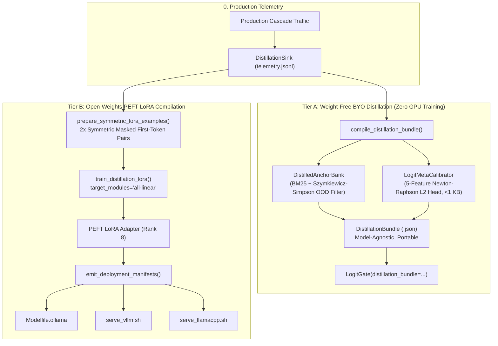

[🏠 README](../../README.md) · [📚 Docs Hub](../README.md) · [⚡ Quick Notes](../quick/quickstart_recipes.md) · [🔬 Deep Architecture](../architecture.md) · [🌱 Visual ELI5](../eli5/how_logitgate_works.md) · [📊 Benchmarks](../benchmarks.md)

---

# Tier-A Weight-Free & Tier-B PEFT LoRA Distillation

> [!NOTE]
> **When You Need This vs. When Standard LogitGate Is Enough**
>
> **Concrete Bottleneck**: Sub-3B edge and CPU models (`llama3.2:1b`, `qwen2.5-coder:1.5b`, `qwen2.5-coder:3b`) often suffer from polarity skew (systematic over-skepticism or sycophancy) and weak edge-case calibration when evaluating nuanced rubrics standalone, forcing expensive escalations to a larger teacher model.
>
> **Quantified Payoff**:
> - **Tier A (Weight-Free Bundle)**: Fits a `<1 KB` `LogitMetaCalibrator` (`621-627 B` JSON) and `<50 KB` `DistilledAnchorBank` in `<20 ms` on CPU with **`0` extra LLM calls** from existing teacher telemetry logs, lifting `qwen2.5-coder:3b` OOD `hard_positive` recall by `+29.2 pp` (`20.8% -> 50.0%`) and bringing `gemma4:e4b` OOD Layer-1 error within `alpha = 0.10` (`9.4% <= 10.0%`).
> - **Tier B (PEFT LoRA)**: Compiles domain rubrics into a rank-8 LoRA adapter (`15-50 MB` at 3B scale) via 2x symmetric first-token SFT so the student requires zero anchor tokens in the prompt at runtime.
>
> **When to Skip It**: In ~90% of production workloads, standard `Cascade` + `CalibrationProfile` with a 3B-4B model already delivers sub-100 ms verification and 10x-20x token savings without distillation. Only reach for Tier A or Tier B when you must run sub-3B edge/CPU models standalone with minimal escalations, want zero-LLM-call recalibration from production telemetry logs, or serve high-volume fixed-domain traffic on dedicated GPUs.

---

<details>
<summary>💡 <b>Intuition: Worked Reference Examples (Tier A) vs. Fine-Tuning Muscle Memory (Tier B)</b></summary>

> - **Standard `LogitGate`**: Runs the base model against your rubric as-is and escalates uncertain log-odds to a Layer-2 judge.
> - **Tier A (`DistillationBundle`, Worked Reference Examples)**: Leaves model weights untouched. Before scoring a new prompt, it prepends 1 matched pass/fail reference pair from past telemetry (`DistilledAnchorBank`, gated so off-domain examples never pollute unrelated prompts) and passes the raw log-odds through a `<1 KB` logistic bias-correction head (`LogitMetaCalibrator`) to cancel systematic skepticism or sycophancy. Because weights never change, the same JSON bundle runs on Ollama, vLLM, llama.cpp, or pure CPU.
> - **Tier B (`train_distillation_lora`, Fine-Tuning Muscle Memory)**: Trains a lightweight rank-8 LoRA adapter on 2x symmetric (`A/B` and `B/A`) first-token examples so the model internalizes the domain boundary directly in its linear projections, removing the need for reference anchors in the prompt prefix.
</details>

---

## Architecture Overview



---

## ⚡ Quick Recipe

### Tier A: Compile a Portable Weight-Free Bundle (Zero LLM Calls)

Tier A compiles a contrastive `DistilledAnchorBank` from a labeled split (`dataset=...`) or both an anchor bank and a 5-feature Newton-Raphson `LogitMetaCalibrator` directly from production `DistillationSink` JSONL logs (`telemetry=...`) with `0` extra LLM calls in under 20 ms on CPU:

```python
from pathlib import Path
from logitgate import LogitGate
from logitgate.distill import compile_distillation_bundle

# 1. Compile model-agnostic anchor bundle from labeled split (0 LLM calls)
#    (Or pass telemetry="logs/distill_telemetry.jsonl" to also fit LogitMetaCalibrator in 0 LLM calls)
bundle = compile_distillation_bundle(
    dataset="benchmarks/data/cal_distill_80.json",
    student_model="llama3.2:3b",
    max_bank_pairs=16,
    target_risk_alpha=0.10,
)

# 2. Save portable JSON artifact (<50 KB)
bundle_path = Path("artifacts/llama3b_distill_bundle.json")
bundle.save(bundle_path)

# 3. Load into LogitGate (zero-shot transfer across any runtime)
gate = LogitGate(
    rubric="Does the SQL query use parameterized statements without raw string interpolation?",
    backend="llama3.2:3b",
    distillation_bundle=bundle_path,
)

verdict = gate.evaluate("cursor.execute('SELECT * FROM users WHERE id = %s', (user_id,))")
print(f"Passed: {verdict.passed} (Calibrated P: {verdict.probability:.4f})")
```

### Tier B: Train an Open-Weights PEFT LoRA Student

Tier B compiles domain rubrics into low-rank adapter weights (`target_modules="all-linear"`) with 2x symmetric position-masked cross-entropy:

```python
from logitgate.distill import (
    LoRADistillConfig,
    train_distillation_lora,
)

# 1. Configure lightweight LoRA distillation
config = LoRADistillConfig(
    rank=8,
    lora_alpha=16,
    learning_rate=2e-4,
    epochs=3,
    batch_size=4,
    target_modules="all-linear",
)

# 2. Train on historical telemetry or calibration examples
manifest = train_distillation_lora(
    dataset="benchmarks/data/cal_distill_80.json",
    base_model="meta-llama/Llama-3.2-3B-Instruct",
    output_dir="distill_output/llama3_lora",
    config=config,
)

print(f"Trained {manifest.num_training_examples} examples. Loss: {manifest.initial_loss:.4f} -> {manifest.final_loss:.4f}")

# 3. Ready-to-run manifests are automatically emitted:
# - distill_output/llama3_lora/Modelfile.ollama
# - distill_output/llama3_lora/serve_vllm.sh
# - distill_output/llama3_lora/serve_llamacpp.sh
```

---

## 🔬 Deep Mechanics: Tier A Weight-Free Distillation

Tier-A distillation requires zero GPU training, zero external optimizer packages, and zero neural network fine-tuning. It packages two complementary mechanisms into a single JSON `DistillationBundle`.

### 1. Contrastive `DistilledAnchorBank` & Szymkiewicz-Simpson OOD Filter

When a compact student model evaluates a nuanced prompt, it often lacks strong in-context grounding for domain edge cases. `DistilledAnchorBank` retrieves matched pairs of positive and negative historical artifacts evaluated under similar rubrics:

1. **Greedy Lexical Pairing**: Historical passing and failing items are paired by Jaccard similarity between candidate texts, creating natural minimal contrastive pairs.
2. **Token-Neutral Rationale Distillation**: Multi-bullet teacher critiques are distilled into a single concise line, systematically stripping explicit references to "Option A" or "Option B" to maintain complete slot symmetry.
3. **Exact Self-Exclusion**: If an incoming candidate matches an anchor's SHA-256 hash, that anchor is strictly excluded from retrieval, preventing self-reinforcing bias.
4. **Szymkiewicz-Simpson Overlap Coefficient Gating**:
   Before injecting anchors into the prompt prefix, the bank measures lexical overlap between query tokens $Q$ and candidate anchor rubric tokens $R$:

   $$\text{Overlap}(Q, R) = \frac{|Q \cap R|}{\min(|Q|, |R|)}$$

   If $\text{Overlap}(Q, R) < \text{min\_rubric\_overlap}$ (default `0.25`), the anchor is rejected as Out-Of-Domain (OOD). This prevents anchors from polluting unrelated rubrics. If all anchors are rejected, `LogitGate` cleanly falls back to unanchored evaluation without crashing.
5. **Shared KV-Cache Prefix Preservation**: Anchors are placed inside `[CALIBRATION ANCHORS]` ahead of `[DECISION MAPPING]`. Both forward ($A=\text{Pass}, B=\text{Fail}$) and reverse ($B=\text{Pass}, A=\text{Fail}$) passes share the identical token prefix, preserving 100% KV-cache reuse.

### 2. 5-Feature Newton-Raphson `LogitMetaCalibrator`

Even with anchors, compact models often exhibit polarity skew (systematic skepticism or sycophancy) or positional bias. `LogitMetaCalibrator` extracts a 5-dimensional feature vector $\mathbf{x} \in \mathbb{R}^5$ from first-token top log-probabilities:

1. **Symmetric Log-Odds**:
   $$x_1 = \frac{1}{2}\left(L_{\text{fwd}} + L_{\text{rev}}\right)$$
2. **Signed Slot Bias**:
   $$x_2 = \frac{1}{2}\left(L_{\text{fwd}} - L_{\text{rev}}\right)$$
3. **Positional Bias Magnitude**:
   $$x_3 = |x_2|$$
4. **Top-$K$ Shannon Entropy (nats)**:
   $$x_4 = -\sum_{i} p_i \ln p_i - p_{\text{res}} \ln p_{\text{res}}$$
5. **Unobserved Residual Mass**:
   $$x_5 = 1 - \sum_{t \in \{A, B\}} p_t$$

The calibrator solves L2-regularized logistic regression via pure-Python Newton-Raphson optimization with Gaussian elimination and partial pivoting (zero NumPy / SciPy runtime dependencies):

$$\mathbf{w}^{(t+1)} = \mathbf{w}^{(t)} - \left(\mathbf{X}^T \mathbf{W} \mathbf{X} + \lambda \mathbf{I}\right)^{-1} \left(\mathbf{X}^T (\mathbf{p} - \mathbf{y}) + \lambda \mathbf{w}^{(t)}\right)$$

The resulting calibrator is serialized to plain JSON (<1 KB). At inference time, calculating $P(\text{pass}) = \sigma(\mathbf{w}^T \mathbf{x} + b)$ takes under $0.01$ ms.

---

## 🔬 Deep Mechanics: Tier B Open-Weights PEFT LoRA Compilation

Tier-B distillation permanently compiles verification behavior into model weights using parameter-efficient fine-tuning (PEFT).

### 1. 2x Symmetric Position Masking (`SymmetricLoRAExample`)

Standard instruction fine-tuning on binary classification causes student models to memorize token priors (e.g., predicting "A" 70% of the time because "A" is presented first).

LogitGate enforces **2x Symmetric First-Token SFT**:
- For every training example, two training rows are generated:
  - **Forward Pass**: $A = \text{Pass}, B = \text{Fail}$, target token is $A$ (if pass) or $B$ (if fail).
  - **Reverse Pass**: $B = \text{Pass}, A = \text{Fail}$, target token is $B$ (if pass) or $A$ (if fail).
- **Prompt Token Masking**: All prompt tokens receive target label `-100` (ignored in PyTorch cross-entropy). Only the single target token ($t=1$) contributes to the loss gradient.
- This forces the LoRA adapter to optimize exclusively for first-token discrimination while canceling positional prior drift.

### 2. Multi-Family `all-linear` Architecture Transfer

The default configuration targets `target_modules="all-linear"`. This dynamically binds LoRA matrices ($A \in \mathbb{R}^{r \times d}, B \in \mathbb{R}^{k \times r}$) to all projection layers across different architectures:
- **Llama 3 / 3.2**: `q_proj`, `k_proj`, `v_proj`, `o_proj`, `gate_proj`, `up_proj`, `down_proj`.
- **Qwen 2 / 2.5**: `q_proj`, `k_proj`, `v_proj`, `o_proj`, `gate_proj`, `up_proj`, `down_proj`.
- **Gemma 2 / 4**: `q_proj`, `k_proj`, `v_proj`, `o_proj`, `gate_proj`, `up_proj`, `down_proj`.
- **Mistral**: `q_proj`, `k_proj`, `v_proj`, `o_proj`, `gate_proj`, `up_proj`, `down_proj`.

### 3. Multi-Runtime Deployment Manifests

`emit_deployment_manifests` produces ready-to-deploy configurations for Ollama, vLLM, and llama.cpp:

#### A. Ollama (`Modelfile.ollama`)
```dockerfile
# LogitGate Distilled Student Adapter (Ollama)
# Build via: ollama create logitgate-student -f Modelfile.ollama
FROM meta-llama/Llama-3.2-3B-Instruct
ADAPTER ./adapter
PARAMETER temperature 0
```

#### B. vLLM (`serve_vllm.sh`)
```bash
#!/usr/bin/env bash
set -euo pipefail
exec vllm serve meta-llama/Llama-3.2-3B-Instruct \
  --enable-lora \
  --lora-modules logitgate-student=./adapter "$@"
```

#### C. llama.cpp (`serve_llamacpp.sh`)
```bash
#!/usr/bin/env bash
# Convert HuggingFace PEFT adapter to GGUF first via llama.cpp:
# python convert_lora_to_gguf.py ./adapter --outfile ./adapter.gguf
set -euo pipefail
BASE_GGUF="${1:?Usage: ./serve_llamacpp.sh /path/to/base-model.gguf}"
shift
exec llama-server -m "$BASE_GGUF" --lora ./adapter.gguf --port 8080 "$@"
```

---

## Complete Verification & Integration Example

The following self-contained script shows how to compile a Tier-A bundle, evaluate candidates with strict conformal safety, and inspect decision features:

```python
from pathlib import Path
from logitgate.distill import (
    DistillationBundle,
    DistilledAnchorBank,
    LogitFeatureVector,
    LogitMetaCalibrator,
    extract_logit_features,
)

# 1. Create a minimal anchor bank with contrastive pairs
bank = DistilledAnchorBank.from_dataset(
    "benchmarks/data/cal_distill_80.json",
    max_bank_pairs=8,
    default_retrieve_pairs=1,
)

# 2. Extract feature vector from synthetic or real logprobs
fwd_logprobs = [
    {"token": "A", "logprob": -0.223},
    {"token": "B", "logprob": -1.609},
]
rev_logprobs = [
    {"token": "B", "logprob": -0.201},
    {"token": "A", "logprob": -1.715},
]
features = extract_logit_features(fwd_logprobs, rev_logprobs)
print(f"Extracted symmetric log-odds: {features.symmetric_log_odds:.4f}")

# 3. Fit a lightweight meta-calibrator (requires >= 10 samples)
sample_features = [
    features,
    LogitFeatureVector(1.8, 0.1, 0.1, 0.18, 0.02),
    LogitFeatureVector(1.2, -0.1, 0.1, 0.25, 0.03),
    LogitFeatureVector(2.1, 0.0, 0.0, 0.12, 0.01),
    LogitFeatureVector(0.9, 0.2, 0.2, 0.31, 0.04),
    LogitFeatureVector(-1.5, 0.0, 0.0, 0.20, 0.05),
    LogitFeatureVector(-2.0, -0.1, 0.1, 0.14, 0.02),
    LogitFeatureVector(-1.1, 0.2, 0.2, 0.28, 0.04),
    LogitFeatureVector(-1.7, 0.1, 0.1, 0.19, 0.03),
    LogitFeatureVector(-0.8, -0.2, 0.2, 0.35, 0.06),
]
sample_labels = [True, True, True, True, True, False, False, False, False, False]

calibrator = LogitMetaCalibrator.fit(
    features=sample_features,
    labels=sample_labels,
    target_risk_alpha=0.10,
    model="llama3.2:3b",
)

# 4. Package into DistillationBundle
bundle = DistillationBundle(
    teacher_model="gemma4:26b",
    student_model="llama3.2:3b",
    anchor_bank=bank,
    meta_calibrator=calibrator,
)

# 5. Save and reload bundle
out_path = Path("/tmp/sample_bundle.json")
bundle.save(out_path)
reloaded = DistillationBundle.load(out_path)
print(f"Bundle loaded successfully. Pairs: {len(reloaded.anchor_bank.pairs)}")
```

---

## Comparison: Tier A vs. Tier B

| Dimension | Tier A: Weight-Free BYO Bundle | Tier B: Open-Weights PEFT LoRA |
| :--- | :--- | :--- |
| **GPU Compute Needed** | **0 GPU hours** (runs on laptop CPU in milliseconds) | 10-30 minutes on single consumer GPU (RTX 4070) |
| **Model Weights** | **Unmodified** (original GGUF / HF checkpoint) | Updated low-rank adapter weights (`adapter_model.safetensors`) |
| **Artifact Size** | **< 50 KB JSON** (< 1 KB for calibrator alone) | 15 MB - 50 MB LoRA adapter safetensors |
| **Runtime Portability** | Works directly with any backend (Ollama, vLLM, llama.cpp, CPU) | Requires runtime with PEFT/LoRA support |
| **OOD Safety** | Szymkiewicz-Simpson rubric gating rejects OOD prompts | Implicitly bounds activations; retains base model fallback |
| **Recommended Use Case** | Fast iterations, multi-tenant setups, air-gapped CPU runners | Millions of daily queries on fixed domains with dedicated GPU |
