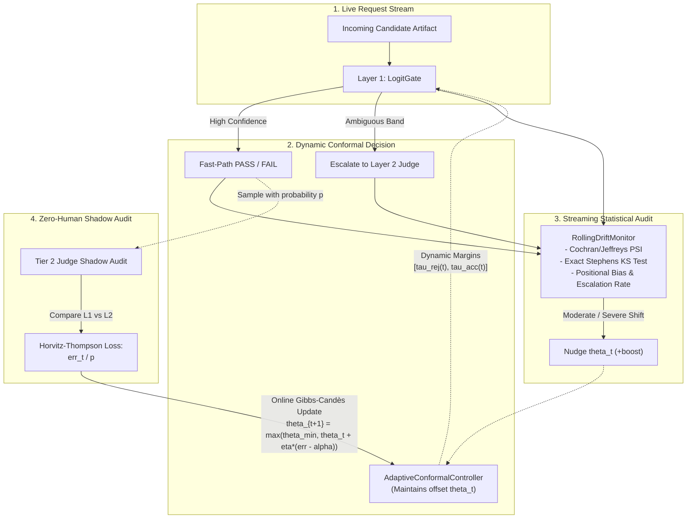

[🏠 README](../../README.md) · [📚 Docs Hub](../README.md) · [⚡ Quick Notes](../quick/quickstart_recipes.md) · [🔬 Deep Architecture](../architecture.md) · [🌱 Visual ELI5](../eli5/how_logitgate_works.md) · [📊 Benchmarks](../benchmarks.md)

---

# Online Drift Detection & Gibbs-Candès Adaptive Conformal Control

> [!NOTE]
> **When You Need This vs. When Standard LogitGate Is Enough**
>
> **Concrete Bottleneck**: Static split-conformal calibration (`fit_calibration_profile` targeting $\alpha^* = 0.05$ or $0.10$) relies on exchangeability between your calibration split and live traffic. When production prompts drift into unseen domains (covariate shift) or face borderline adversarial inputs, fixed thresholds ($\tau_{\text{rej}}, \tau_{\text{acc}}$) silently exceed your target Layer-1 error rate.
>
> **Quantified Payoff**: Coupling `RollingDriftMonitor` and `AdaptiveConformalController` with `cascade_audit` automatically widens the ambiguous escalation band during distribution shifts and relaxes it back down once traffic recovers. Across the 120-step 4-regime shift benchmark with **`0` human labels**, `cascade_audit` (`p = 0.25`) cuts Layer-1 selective risk from `9.2% -> 4.2%` on `gemma4:e4b`, `5.8% -> 3.3%` on `qwen2.5-coder:3b`, and `4.2% -> 1.7%` on `qwen2.5:14b` (reducing Regime-3 adversarial L1 errors to `0.0%` on all three `3B`/`4B` models).
>
> **When to Skip It**: If your traffic distribution is stationary (same domain, prompt format, and error profile as your calibration holdout), static `Cascade` + `CalibrationProfile` handles ~90% of workloads with finite-sample coverage guarantees and zero runtime tracking overhead. Only enable online drift monitoring and adaptive control for non-stationary streams, adversarial exposure, or long-running services needing autonomous margin control without manual relabeling.

---

<details>
<summary>💡 <b>Plain-Language Intuition: Cruise Control That Leaves Extra Following Distance in Heavy Rain</b></summary>

> Static pass/fail cutoffs are like cruise control tuned for dry pavement: as long as live traffic looks like your test set, a fixed following distance stays safe.
>
> When sudden rain or unfamiliar road conditions arrive (new user topics or adversarial prompts), a fixed margin is too tight:
> - **Road Sensor (Drift Monitor)**: Watches a rolling window of live scores to spot when incoming requests look noticeably different from normal traffic.
> - **Automatic Following-Distance Adjuster (Adaptive Controller)**: Whenever the fast check makes a mistake, it widens the middle gray zone so more borderline items get a careful Stage-2 review. Once requests settle back down, it gradually narrows the gray zone back toward normal speed.
> - **Random Spot Checks (Zero Human Labeling)**: Because humans are not grading live traffic in real time, the system randomly double-checks a small slice (say `10%`) of fast-lane decisions with the full Stage-2 reviewer to keep its error estimate honest automatically.
</details>

---

## Closed-Loop Architecture



---

## ⚡ Quick Recipe

### 1. Online Streaming Cascade with Autonomous Shadow Auditing

Attach `RollingDriftMonitor` and `AdaptiveConformalController` directly to your production `Cascade`. Fast-path Layer-1 decisions are automatically audited by Tier-2 `JudgeGate` with probability `audit_sample_rate=0.05` ($p=0.05$), updating thresholds with zero human labels:

```python
from logitgate import (
    AdaptiveConformalController,
    Cascade,
    JudgeGate,
    LogitGate,
    RollingDriftMonitor,
)

# 1. Initialize Gibbs-Candes online adaptive controller
controller = AdaptiveConformalController(
    pass_threshold=0.85,
    fail_threshold=0.20,
    target_risk_alpha=0.05,
    step_size=1.5,
    audit_sample_rate=0.05,  # 5% random shadow audit of Layer-1 fast paths
)

# 2. Initialize rolling drift monitor with automatic controller boost
monitor = RollingDriftMonitor(
    baseline_window=30,
    current_window=30,
    check_every=10,
    adaptive_controller=controller,
    drift_boost_theta=0.5,
)

# 3. Assemble self-healing Cascade
cascade = Cascade(
    gates=[
        LogitGate(
            rubric="Is the customer support response professional and compliant?",
            backend="llama3.2:3b",
            adaptive_controller=controller,
            telemetry_sink=monitor,
        ),
        JudgeGate(
            rubric="Is the customer support response professional and compliant?",
            backend="gemma4:26b",
            trigger="on_ambiguous_only",
        ),
    ]
)

# 4. Evaluate production stream
verdict = cascade.evaluate("Thank you for contacting support. Your refund has been processed.")
print(f"Status: {verdict.status.value}, Escalated: {verdict.escalated}, Current theta: {controller.theta:.4f}")
```

### 2. Inspecting Production Drift via the CLI

Compare historical baseline telemetry against an active production traffic window:

```bash
# Detect distribution shift between baseline and current production logs
logitgate telemetry drift \
  --reference logs/telemetry_baseline.jsonl \
  --psi-moderate 0.10 \
  --psi-severe 0.25 \
  logs/telemetry_production.jsonl
```

Sample CLI output:
```text
============================================================
LOGITGATE TELEMETRY DISTRIBUTION DRIFT REPORT
============================================================
Reference Samples:         1200
Current Samples:           350
Drift Detected:            True (SEVERE)
Action:                    widen_band_or_recalibrate
------------------------------------------------------------
PSI (Log-Odds):            0.3142 (severe shift >= 0.25)
KS Test (Log-Odds):        statistic=0.2840, p=0.000001
PSI (Calibrated Prob):     0.2891 (severe shift >= 0.25)
KS Test (Prob):            statistic=0.2612, p=0.000004
Mean Log-Odds Shift:       +1.8420 -> +0.4105 (Delta: -1.4315)
Positional Bias Delta:     +0.0421 -> +0.1830 (Delta: +0.1409)
Escalation Rate Delta:     12.5% -> 38.2% (+25.7 pp)
Teacher Disagreement Rate: 6.8% of escalations
============================================================
```

---

## 🔬 Deep Mechanics: Rolling Drift Detection

`RollingDriftMonitor` is a thread-safe, non-blocking `TelemetrySink` that runs online statistical tests across sliding windows without third-party scientific library dependencies.

### 1. Cochran-Rule Adaptive Quantile Binned PSI with Jeffreys Smoothing

The Population Stability Index (PSI) measures the divergence between a reference distribution $P$ and a current distribution $Q$:

$$\text{PSI} = \sum_{k=1}^B (q_k - p_k) \ln\left(\frac{q_k}{p_k}\right)$$

In production rolling windows ($N \approx 30\text{--}100$), standard fixed-bin PSI fails due to empty bins (causing infinite log-ratios) or over-binning. `RollingDriftMonitor` implements:

1. **Cochran's Minimum-Cell Rule**: Bin count $B$ dynamically scales to guarantee an expected count of $\ge 5$ items per bin:
   $$B = \min\left(\text{num\_bins}, \max\left(2, \left\lfloor \frac{\min(N_{\text{ref}}, N_{\text{cur}})}{5} \right\rfloor\right)\right)$$
2. **Quantile Boundary Estimation**: Bin edges are derived from reference quantiles, ensuring balanced baseline cells.
3. **Jeffreys Prior ($\epsilon = 0.5$) Smoothing**: Pseudo-counts prevent division by zero while preserving asymptotic divergence properties:
   $$p_k = \frac{r_k + 0.5}{N_{\text{ref}} + B \cdot 0.5}, \qquad q_k = \frac{c_k + 0.5}{N_{\text{cur}} + B \cdot 0.5}$$

**Interpretation Rubric**:
- $\text{PSI} < 0.10$: Negligible shift. Baseline calibration remains trustworthy.
- $0.10 \le \text{PSI} < 0.25$: Moderate shift. Monitor closely; consider small adaptive safety nudges.
- $\text{PSI} \ge 0.25$: Severe distributional shift. Automatic margin widening or recalibration required.

### 2. Exact Stephens Two-Sample Kolmogorov-Smirnov Test

To detect subtle shape changes and multi-modal splits without binning artifacts, `compute_ks_two_sample` computes the exact empirical cumulative distribution difference:

$$D = \sup_x |F_{\text{ref}}(x) - F_{\text{cur}}(x)|$$

Using the Stephens (1970) small-sample modification for the Kolmogorov-Smirnov asymptotic expansion:

$$N_{\text{eff}} = \frac{N_{\text{ref}} \cdot N_{\text{cur}}}{N_{\text{ref}} + N_{\text{cur}}}, \qquad \lambda = \left(\sqrt{N_{\text{eff}}} + 0.12 + \frac{0.11}{\sqrt{N_{\text{eff}}}}\right) D$$

$$p\text{-value} = 2 \sum_{j=1}^{100} (-1)^{j-1} \exp\left(-2 j^2 \lambda^2\right)$$

This allows exact hypothesis testing ($p < \alpha_{\text{KS}}$, default $0.01$) without importing SciPy.

### 3. Multi-Signal Diagnostic Suite

`RollingDriftMonitor` tracks five simultaneous production signals:
1. **Log-Odds PSI & KS**: Measures underlying model confidence distributions.
2. **Probability PSI & KS**: Measures changes in calibrated output risk.
3. **Positional Bias Delta**: Detects prompt ordering susceptibility shifts.
4. **Escalation Rate Delta**: Flags surges in ambiguous-band traffic.
5. **Teacher Disagreement Rate**: Tracks how often Tier-2 `JudgeGate` contradicts Tier-1 `LogitGate`.

---

## 🔬 Deep Mechanics: Gibbs-Candès Adaptive Conformal Control

Static conformal prediction assumes that calibration data and production data are independent and identically distributed (exchangeable). Under covariate shift or adversarial prompting, exchangeability breaks, causing empirical risk to violate the target risk $\alpha^*$.

`AdaptiveConformalController` implements the **Gibbs-Candès (2021) Online Adaptive Conformal Inference (ACI)** algorithm adapted to symmetric log-odds thresholds.

### 1. Dynamic Margin Parametrization

Let $(\tau_{\text{rej},0}, \tau_{\text{acc},0})$ be baseline calibrated probability thresholds. The controller maps these to baseline log-odds:

$$L_{\text{acc},0} = \operatorname{logit}(\tau_{\text{acc},0}), \qquad L_{\text{rej},0} = \operatorname{logit}(\tau_{\text{rej},0})$$

At time step $t$, the controller maintains a scalar safety margin $\theta_t \ge \theta_{\min}$ (default $\theta_1 = 0$):

$$\tau_{\text{acc},t} = \sigma\left(L_{\text{acc},0} + \theta_t\right), \qquad \tau_{\text{rej},t} = \sigma\left(L_{\text{rej},0} - \theta_t\right)$$

As $\theta_t$ increases, the acceptance threshold $\tau_{\text{acc},t}$ rises towards $1.0$ and the rejection threshold $\tau_{\text{rej},t}$ falls towards $0.0$, widening the ambiguous band and escalating more traffic to Layer 2.

### 2. Online Update Equation

After each evaluated artifact, $\theta_t$ updates according to observed error $\text{err}_t \in \{0, 1\}$:

$$\theta_{t+1} = \max\left(\theta_{\min},\; \theta_t + \eta \left(\hat{\text{err}}_t - \alpha^*\right)\right)$$

where:
- $\eta > 0$ is the learning step size (default `1.5`).
- $\alpha^* \in (0, 1)$ is the target selective risk bound (default `0.05`).
- $\hat{\text{err}}_t$ is the evaluated loss.

If Layer 1 commits an error ($\hat{\text{err}}_t = 1$), $\theta_{t+1}$ increases by $\eta (1 - \alpha^*)$, widening the safety band.
If Layer 1 is correct ($\hat{\text{err}}_t = 0$), $\theta_{t+1}$ decreases by $\eta \alpha^*$, gradually recovering throughput.

### 3. Upper-Clip Bias Prevention via Forced Ambiguity (`theta_abstain`)

In naive bounded ACI, clamping $\theta_t \le \theta_{\max}$ introduces positive drift bias because errors incurred at the ceiling cannot increase $\theta_t$ further.

LogitGate solves this via **Forced Ambiguity**:
When $\theta_t \ge \theta_{\text{abstain}}$ (default `8.0` log-odds units):
1. `controller.force_ambiguous` activates.
2. Layer 1 abstains on 100% of inputs, routing all traffic to Tier-2 `JudgeGate`.
3. Because Layer 1 abstained, no Layer-1 error can occur ($\text{err}_t = 0$).
4. The update equation forces $\theta_t$ to decay deterministically by $\eta \alpha^*$ per evaluation:
   $$\theta_{t+1} = \theta_t - \eta \alpha^*$$
5. Once $\theta_t < \theta_{\text{abstain}}$, selective Layer-1 fast paths resume.

### 4. Telescoping Risk Guarantee Over Arbitrary Sequences

By telescoping the update equation over any arbitrary (even adversarial) sequence of length $T$:

$$\frac{1}{T} \sum_{t=1}^T \mathbb{E}[\text{err}_t] \le \alpha^* + \frac{\theta_{\text{abstain}} + \eta - \theta_1}{\eta T}$$

As $T \to \infty$, the average selective error rate converges to $\le \alpha^*$ regardless of distribution shift!

### 5. Zero-Human-Label Horvitz-Thompson Shadow Auditing (`cascade_audit`)

In production, ground truth labels are rarely available immediately. Setting `feedback_mode="cascade_audit"` and `audit_sample_rate=p` (e.g. $p=0.05$) creates a closed feedback loop:

1. When Layer 1 issues a fast-path decision, it randomly samples that item with Bernoulli probability $p$.
2. The sampled item is asynchronously evaluated by Tier-2 `JudgeGate`.
3. If Tier 2 contradicts Tier 1, an error is recorded: $\text{err}_t = 1$.
4. The error is scaled by the Horvitz-Thompson inverse-propensity weight:
   $$\hat{\text{err}}_t = \frac{\text{err}_t}{p}$$
5. Non-audited items contribute $\hat{\text{err}}_t = 0$.

Because $\mathbb{E}[\hat{\text{err}}_t] = \text{err}_t$, the estimator is mathematically unbiased, allowing the controller to adapt in real time with zero human labeling.

---

## Complete Verification & Integration Example

The following standalone script verifies dynamic threshold widening under simulated adversarial shift:

```python
from logitgate import (
    AdaptiveConformalController,
    DecisionStatus,
    LogitGate,
    RollingDriftMonitor,
    StubBackend,
)

# 1. Initialize controller targeting 5% error with step size 1.0
controller = AdaptiveConformalController(
    pass_threshold=0.85,
    fail_threshold=0.20,
    target_risk_alpha=0.05,
    step_size=1.0,
)

# 2. Attach rolling drift monitor
monitor = RollingDriftMonitor(
    baseline_window=10,
    current_window=10,
    check_every=5,
    adaptive_controller=controller,
    drift_boost_theta=0.5,
)

# 3. Setup stub gate with initial thresholds
gate = LogitGate(
    "Verify adherence to security policy",
    backend=StubBackend(default_prob=0.86),
    adaptive_controller=controller,
    telemetry_sink=monitor,
    save_on_fail=False,
)

# Initial state: passes because 0.86 >= 0.85
v1 = gate.evaluate("harmless input")
print(f"Step 1: status={v1.status.value}, theta={controller.theta:.2f}")

# Simulate observing 2 false passes (adversarial evasion)
controller.observe(v1, ground_truth=False)
controller.observe(v1, ground_truth=False)

# Theta has expanded by 2 * (1.0 * (1 - 0.05)) = +1.90 log-odds units!
fail_t, pass_t, force_ambiguous = controller.current_thresholds()
print(f"After errors: theta={controller.theta:.2f}, force_ambiguous={force_ambiguous}")
print(f"Dynamic thresholds are now: fail={fail_t:.4f}, pass={pass_t:.4f}")

# Re-evaluating same input: 0.86 is now below dynamic pass threshold -> AMBIGUOUS!
v2 = gate.evaluate("harmless input")
assert v2.status == DecisionStatus.AMBIGUOUS
print(f"Step 2: status={v2.status.value} (safely escalated to Tier 2!)")
```

---

## Operational Guide: Setting Hyperparameters

| Parameter | Recommended Default | Effect of Increasing | When to Adjust |
| :--- | :--- | :--- | :--- |
| `target_risk_alpha` | `0.05` (5% risk) | Narrows ambiguous band; increases fast-path rate | Lower to `0.01` for safety-critical medical / legal tasks |
| `step_size` ($\eta$) | `1.5` | Reacts faster to errors; causes wider threshold oscillations | Increase if attacks are sudden; decrease for stable traffic |
| `audit_sample_rate` ($p$) | `0.05` (5%) | Better error estimation; higher Layer-2 token consumption | Increase to `0.10` during Canary releases; reduce to `0.02` at scale |
| `baseline_window` | `30` - `100` | Smoother reference distribution; slower to initialize | Increase if baseline traffic is highly diverse |
| `drift_boost_theta` | `0.5` - `1.0` | Proactively widens safety band on statistical drift | Increase in zero-tolerance compliance pipelines |
