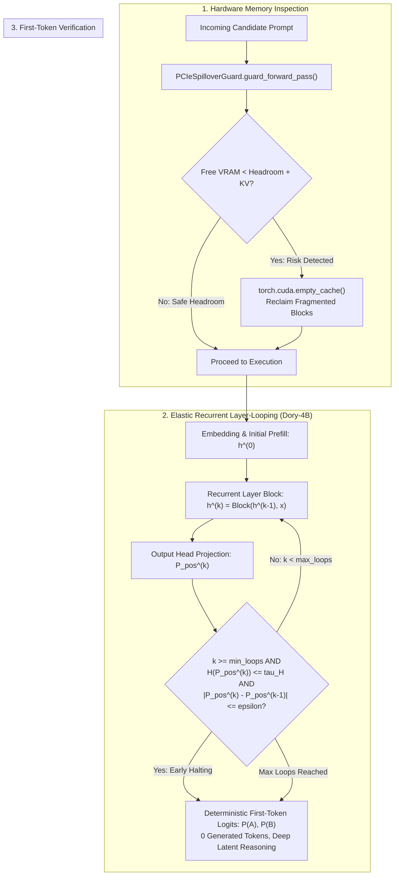

[🏠 README](../../README.md) · [📚 Docs Hub](../README.md) · [⚡ Quick Notes](../quick/quickstart_recipes.md) · [🔬 Deep Architecture](../architecture.md) · [🧭 Visual Guide](../eli5/how_logitgate_works.md) · [📊 Benchmarks](../benchmarks.md)

---

# Elastic Recurrent Layer-Looping & PCIe Hardware Guardrails

> [!NOTE]
> **When You Need This vs. When Standard LogitGate Is Enough**
>
> **Concrete Bottlenecks**:
> 1. **Single-Pass Circuit-Depth Ceiling**: Standard causal transformers execute one pass through $L$ layers (`O(1)` sequential depth), so multi-step deductive constraints or nested logic often fail unless the model generates 200+ Chain-of-Thought tokens.
> 2. **Silent PCIe VRAM Paging**: When multi-model cascades or long-context KV-caches exceed physical VRAM on shared GPUs (e.g., 12 GB RTX 4070 or 24 GB RTX 3090/4090), CUDA Unified Memory silently pages allocations over PCIe (`32-64 GB/s` vs. `1,000-1,800 GB/s` VRAM) without throwing `CUDA OOM`, degrading latency by `10x-50x`.
>
> **Quantified Payoff**:
> - **Elastic Recurrent Looping ($K=2$)**: Delivers a **`+12.5 pp` reasoning gain** on `NVIDIA-Nemotron-Labs Dory-4B` (`53.1% -> 65.6%` on RTX 5090; `50.0% -> 62.5%` on RTX 4070) and doubles `ScoreGate` monotonicity (`37.5% -> 75.0%`) at **`0` generated tokens** and a constant 4B VRAM footprint.
> - **Proactive VRAM Guardrails (`PCIeSpilloverGuard`)**: Inspects physical free VRAM via `torch.cuda.mem_get_info()` and triggers `torch.cuda.empty_cache()` whenever headroom falls below `min_free_headroom_mb + estimated_kv_mb` (or reserved memory exceeds `96%`), preventing silent PCIe swap-thrashing.
>
> **When to Skip It**: In ~90% of deployments, standard feed-forward models (`qwen2.5-coder:3b`, `llama3.2:3b`, `gemma4:e4b`) behind `Cascade` + `CalibrationProfile` already evaluate classification, RAG groundedness, and policy rubrics in `15-45 ms` on GPU with zero custom PyTorch runtime setup.

---

<details>
<summary>💡 <b>Re-Reading Before Answering, and Checking Free VRAM Early</b></summary>

> When checking a tricky multi-step rule, an AI has three ways to work:
> 1. **Single Glance**: Read the prompt once and answer right away. Very fast, but easy to miss a two-step logical catch.
> 2. **Thinking Out Loud**: Write out 200 words of notes before giving the verdict. Accurate, but slow because writing words one by one takes seconds.
> 3. **Re-Reading Silently (Recurrent Looping)**: Pass the prompt through the model's middle layers twice in silence before scoring the first word. A compact 4B model gets a second look at the logic without using extra GPU memory or writing a single word out loud.
>
> Meanwhile, the **VRAM Headroom Guard** works like checking free laptop memory before opening a huge project so your computer never freezes while swapping to a slow disk: by clearing leftover GPU scratch memory ahead of time, it prevents sudden `10x-50x` slowdowns when memory gets tight.
</details>

---

## Architectural Workflow



---

## ⚡ Quick Recipe

### 1. Elastic Recurrent Gating (`recurrent://` Fixed-$K$ & Adaptive Early-Halting)

Use the `recurrent://` URI scheme (`RecurrentPyTorchBackend`) for fixed $K$-loop depth scaling inside `LogitGate`, or invoke `execute_adaptive_recurrent_loops()` directly when running custom step-by-step early halting over recurrent blocks:

```python
from logitgate import LogitGate
from logitgate.backends.dory_recurrent import execute_adaptive_recurrent_loops

# 1. Fixed K-loop recurrent backend (num_loops=2 passes through the recurrent block)
gate = LogitGate(
    rubric="Does the SQL query use parameterized statements without string concatenation?",
    backend="recurrent://nvidia/NVIDIA-Nemotron-Labs-Dory1.0-4B-BF16?num_loops=2&device=cuda",
)

verdict = gate.evaluate("cursor.execute('SELECT * FROM users WHERE id = %s', (uid,))")
print(f"Passed: {verdict.passed} (Calibrated P: {verdict.probability:.4f})")

# 2. Adaptive per-loop early halting over a recurrent hidden-state block
trace = execute_adaptive_recurrent_loops(
    initial_hidden_state=[0.0, 0.0],
    recurrent_step_fn=lambda h, step: [h[0] + 2.5, h[1] - 2.5],
    lm_head=lambda h: {319: h[0], 65: h[0] - 1.0, 350: h[1], 66: h[1] - 1.0},
    min_loops=2,
    max_loops=6,
    entropy_halt_threshold=0.12,
    kl_stability_threshold=0.005,
)
print(f"Loops executed: {trace.loops_executed}, halted_early={trace.halted_early}")
```

### 2. Proactive VRAM Watermark Protection with `PCIeSpilloverGuard`

Wrap Layer-1 and Layer-2 prefill passes inside `PCIeSpilloverGuard` to prevent silent CUDA unified memory paging over PCIe:

```python
from logitgate.hardware.memory_guard import PCIeSpilloverGuard

# 1. Initialize guard monitoring GPU 0 with 512 MB minimum headroom
guard = PCIeSpilloverGuard(device_index=0, min_free_headroom_mb=512.0)

# 2. Inspect current hardware memory status
status = guard.inspect()
print(f"Free VRAM: {status.free_physical_mb:.1f} MB / {status.total_physical_mb:.1f} MB")
print(f"Spillover Risk: {status.spillover_risk_detected}")

# 3. Guard prefill pass with estimated 128 MB KV-cache allocation
with guard.guard_forward_pass(estimated_kv_mb=128.0) as st:
    # Safe forward pass: empty_cache() automatically triggers if headroom is tight
    pass
```

---

## 🔬 Deep Mechanics: Elastic Recurrent Layer-Looping

A standard causal transformer evaluates its first token in a single forward pass through $L$ attention layers. This represents an $O(1)$ sequential circuit depth. Standard models cannot compute multi-digit arithmetic, state machines, or nested boolean logic in a single pass without emitting intermediate Chain-of-Thought (`<think>`) tokens.

### 1. Latent Reasoning in Hidden-State Space

Architectures like **NVIDIA-Nemotron-Labs Dory** (`nvidia/NVIDIA-Nemotron-Labs-Dory1.0-4B-BF16`) introduce **elastic recurrent depth**. Instead of traversing intermediate transformer layers once, Dory recirculates hidden state representations through a shared recurrent block for $K$ iterations (`num_loops`, typically 1 to 4) before projecting to output logits:

$$
\mathbf{h}^{(k)} = \text{RecurrentLayerBlock}\left(\mathbf{h}^{(k-1)}, \mathbf{x}\right), \quad k \in \{1, \dots, K\}
$$

$$
\mathbf{y} = \text{Softmax}\left(\mathbf{W}_{\text{head}} \mathbf{h}^{(K)}\right)
$$

- **Computational Depth without Parameter Bloat**: Looping twice ($K=2$) gives a 4B model the effective computational depth of an 8B model, while keeping the VRAM memory footprint strictly at 4B.
- **Zero Generated Tokens**: Because reasoning occurs purely in latent hidden-state space, the model emits its final verification decision on token 1, completely avoiding autoregressive decoding latency.

### 2. Fixed-$K$ `RecurrentPyTorchBackend` vs. Adaptive Early-Halting

LogitGate exposes two complementary interfaces for recurrent layer-looping depending on whether your model executes loops inside `model.forward(...)` or via step-by-step hidden-state probing:

- **Fixed-$K$ Depth Scaling (`RecurrentPyTorchBackend` / `recurrent://...?num_loops=2`)**: Passes a fixed `num_loops=K` argument into `model(**inputs, num_loops=K)` (and `load_dory_model(...)`) inside `PCIeSpilloverGuard.guard_forward_pass()`, recirculating hidden states $K$ times before extracting first-token `top_logprobs`.
- **Adaptive Per-Loop Early Halting (`execute_adaptive_recurrent_loops()`)**: Imported via `from logitgate.backends.dory_recurrent import execute_adaptive_recurrent_loops`, this helper steps a recurrent block up to `max_loops` iterations, projects only the final token position $\mathbf{h}^{(k)}_{[-1]}$ through `final_norm` and `lm_head` at each step, marginalizes the binary pass-pole probability $P_{\text{pos}}^{(k)}$ over `SurfaceTokenMap`, and halts early once $k \ge \text{min\_loops}$ and both binary Shannon entropy and consecutive probability delta converge:

$$
H\!\left(P_{\text{pos}}^{(k)}\right) \le \text{entropy\_halt\_threshold} \quad \text{AND} \quad \left|P_{\text{pos}}^{(k)} - P_{\text{pos}}^{(k-1)}\right| \le \text{kl\_stability\_threshold}
$$

Returning a `RecurrentLoopTrace(loops_executed, entropy_trajectory, halted_early, final_logits)` preserves multi-loop depth on hard edge cases while cutting prefill work on obvious items.

### 3. URI Parameter Reference (`RecurrentPyTorchBackend`)

The `recurrent://` URI scheme resolves `RecurrentPyTorchBackend` with the following query parameters:

| Parameter | Type | Default | Description |
| :--- | :---: | :---: | :--- |
| `num_loops` | `int` | `2` | Fixed number of recurrent loop iterations executed per forward pass (`>= 1`). |
| `min_loops` | `int` | `None` | Optional metadata attribute recorded on `RecurrentPyTorchBackend`. |
| `max_loops` | `int` | `None` | Optional metadata attribute recorded on `RecurrentPyTorchBackend`. |
| `kl_threshold` | `float` | `None` | Optional metadata attribute recorded on `RecurrentPyTorchBackend`. |
| `device` | `str` | `"cuda"` | Compute device (`"cuda"`, `"cuda:0"`, `"cpu"`, or `"auto"`). |

---

## 🔬 Deep Mechanics: PCIe Memory Guardrails

Modern deep learning frameworks on Linux and Windows/WSL2 use CUDA Unified Memory. When GPU allocations exceed physical card capacity, the NVIDIA driver does not immediately throw an Out-Of-Memory (`CUDA OOM`) error. Instead, it **silently pages memory across the PCIe bus to host DDR RAM**.

### 1. The PCIe Latency Cliff

| Memory Hierarchy | Typical Bandwidth | Latency Impact |
| :--- | :---: | :---: |
| **GPU VRAM (GDDR6X / GDDR7)** | **1,000 to 1,800 GB/s** | Baseline (~15 ms to ~45 ms per pass) |
| **PCIe 4.0 / 5.0 Bus Paging** | **32 to 64 GB/s** | **10x to 50x slowdown** (~1,500 ms to ~3,000 ms per pass) |

A cascade designed to deliver 50 ms decisions suddenly degrades to 2,000 ms decisions without throwing any error in application logs.

### 2. `PCIeSpilloverGuard` Protection Lifecycle

`PCIeSpilloverGuard` acts as an active physical memory sentry:

1. **Hardware Memory Query**: Directly interrogates `torch.cuda.mem_get_info(device_index)` to read physical free and total bytes without PyTorch caching distortion.
2. **Spillover Condition**:

   $$
   \text{free\_mb} < \text{min\_free\_headroom\_mb} + \text{estimated\_kv\_mb} \quad \text{OR} \quad \text{reserved\_mb} > 0.96 \cdot \text{total\_mb}
   $$

3. **Proactive Cache Eviction**: If spillover risk is detected and `auto_empty_cache=True`, it triggers `torch.cuda.empty_cache()` immediately before prefill buffers are allocated, returning unused cached blocks to the driver.

---

## Empirical Benchmark Highlights (NVIDIA Dory-4B)

Evaluated across NVIDIA GeForce RTX 5090 (32 GB) and RTX 4070 (12 GB) on the 32-item reasoning depth benchmark:

| Recurrent Depth | Tier A (Surface) | Tier B (Compound) | Tier C (Multi-Hop) | Tier D (Adversarial) | Overall 32-Item Reasoning | First-Token Latency (RTX 5090) |
| :---: | :---: | :---: | :---: | :---: | :---: | :---: |
| **$K=1$ Loop** | 4/8 (50.0%) | 4/8 (50.0%) | 6/8 (75.0%) | 3/8 (37.5%) | **17/32 (53.1%)** | **216.3 ms** |
| **$K=2$ Loops** | 5/8 (62.5%) | **6/8 (75.0%)** | 6/8 (75.0%) | 4/8 (50.0%) | **21/32 (65.6%)** *(+12.5 pp)* | **335.5 ms** |
| **$K=4$ Loops** | 4/8 (50.0%) | 4/8 (50.0%) | 5/8 (62.5%) | 5/8 (62.5%) | **18/32 (56.2%)** | **628.9 ms** |
| *Baseline Feed-Forward 4B* | *6/8 (75.0%)* | *4/8 (50.0%)* | *4/8 (50.0%)* | *4/8 (50.0%)* | *18/32 (56.2%)* | *76.0 ms* |

*Note: The feed-forward 4B (`56.2%`, `gemma4:e4b`) and 14B (`68.8%`, `qwen2.5:14b`) comparison figures are uncalibrated single-pass baselines; calibrated 2-pass accuracy reaches `93.8%` and `87.5%` respectively in [Benchmarks](../benchmarks.md).*

**Key Takeaways**:
- **Sweet Spot at $K=2$**: Looping twice provides a **+12.5 percentage point accuracy jump** over $K=1$, outperforming the uncalibrated single-pass feed-forward 4B baseline (`56.2%`, `gemma4:e4b`) and approaching the uncalibrated single-pass 14B baseline (`68.8%`, `qwen2.5:14b`) with zero generated tokens.
- **Diminishing Returns at $K=4$**: Deep latent looping without intermediate normalization can cause representation oversaturation on surface tasks. $K=2$ is the best operating point for latency and accuracy.

---

## Complete Verification & Integration Example

The following script verifies that `RecurrentPyTorchBackend` parameters parse cleanly and `PCIeSpilloverGuard` correctly reports hardware headroom:

```python
from logitgate.backends import resolve_logit_backend
from logitgate.backends.recurrent import RecurrentPyTorchBackend
from logitgate.hardware.memory_guard import PCIeSpilloverGuard

# 1. Verify URI parsing for recurrent backend
backend = resolve_logit_backend(
    "recurrent://nvidia/NVIDIA-Nemotron-Labs-Dory1.0-4B-BF16?num_loops=2&kl_threshold=0.02&device=cpu"
)
assert isinstance(backend, RecurrentPyTorchBackend)
print(f"Backend resolved: {backend.model_name}, num_loops={backend.num_loops}, kl_threshold={backend.kl_threshold}")

# 2. Verify hardware memory guard on current platform
guard = PCIeSpilloverGuard(device_index=0, min_free_headroom_mb=256.0)
status = guard.inspect()
print(f"CUDA Available: {status.total_physical_mb > 0}")
print(f"VRAM Watermark Status: allocated={status.allocated_mb} MB, free={status.free_physical_mb} MB")

# 3. Guard a simulated execution block
with guard.guard_forward_pass(estimated_kv_mb=64.0) as st:
    print(f"Forward pass executed safely. Spillover risk: {st.spillover_risk_detected}")
```

---

[🏠 README](../../README.md) · [📚 Docs Hub](../README.md) · [⚡ Quick Notes](../quick/quickstart_recipes.md) · [🔬 Deep Architecture](../architecture.md) · [🧭 Visual Guide](../eli5/how_logitgate_works.md) · [📊 Benchmarks](../benchmarks.md)
