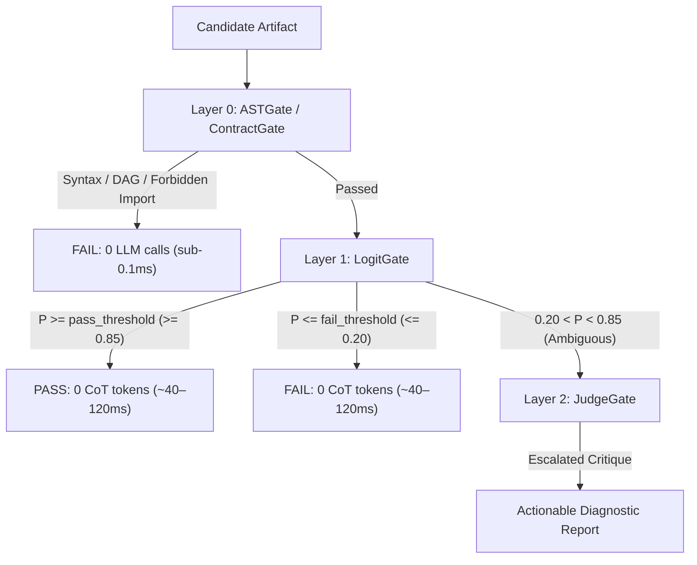

# 3-Layer Cascaded Router Architecture & Deployment Topologies

This document provides a comprehensive architectural breakdown of the **LogitGate** evaluation pipeline, its execution mechanics, short-circuiting rules, and production deployment topologies.

---

## 3-Layer Cascaded Router Architecture

### Layer Execution Breakdown

1. **Layer 0 (`ASTGate` / `ContractGate`)**:
   - **Latency**: Sub-millisecond (~0.04 ms on CPU).
   - **Cost**: Zero LLM calls, zero tokens, zero GPU memory.
   - **Mechanics**: Deterministically verifies structural contracts before any neural network invocation:
     - Python AST syntax trees (`syntax=True`).
     - Forbidden imports (`forbidden_imports=["os", "sys", "subprocess"]`).
     - Forbidden regex patterns (`forbidden_patterns`).
     - Required document sections (`required_sections`).
     - Character length bounds (`min_length`, `max_length`).
     - Pydantic models & JSON Schemas (`json_schema`).
     - Task dependency acyclic DAG cycles (`acyclic_dag=True`).
     - Arbitrary user-defined callables (`validators`).
   - If an artifact fails Layer 0, the pipeline halts immediately with `passed=False` and `status=DecisionStatus.FAILED`.

2. **Layer 1 (`LogitGate` / `ChoiceGate` / `ScoreGate`)**:
   - **Latency**: ~36–41 ms (single-pass GPU), ~90–113 ms (2-pass debiased GPU), ~170–640 ms (CPU).
   - **Output Tokens**: **0 autoregressive Chain-of-Thought tokens**.
   - **Mechanics**: Reads the model's raw first-token log-probabilities (`max_tokens=1`) under greedy decoding.
     - **Binary Pass/Fail (`LogitGate`)**: Runs forward ($A=\text{Pass}, B=\text{Fail}$) and reverse ($B=\text{Pass}, A=\text{Fail}$) passes to cancel pretraining token priors and positional bias, abstaining (`DecisionStatus.AMBIGUOUS`) inside `fail_threshold < P < pass_threshold`, when target tokens are unobserved, or when `max_positional_bias` sign-flip divergence is exceeded.
     - **Discrete K-ary Selection (`ChoiceGate`)**: Normalizes probabilities across $K$ options using forward and reverse permutation averaging (`derangement`, `cyclic`, or `reverse`), supporting selective `AMBIGUOUS` abstention on unobserved target tokens (`choice=None`), `min_confidence`, or `min_margin` (`top2_margin`) so low-confidence routes can escalate to Layer 2.
     - **Continuous Scoring (`ScoreGate`)**: Computes probability-weighted expected scores ($\mathbb{E}[S] = \sum s \cdot P(s)$) over discrete anchors (1 to 5) with scale reversal, supporting selective `AMBIGUOUS` abstention on unobserved target tokens (`score=None`), uncertainty band `fail_threshold < E[S] < threshold`, or bimodal dispersion `score_std > max_score_std`.
     - **Thinking Prefill Suppression & Warm Prefixing**: Layer-1 backends automatically suppress reasoning prefill tokens (`OllamaBackend` sends `think=False` with legacy HTTP 400 opt-out; `OpenAICompatBackend` sends `reasoning_effort="none"` with sticky HTTP 400/422 opt-out and automatic `chat_template_kwargs={"enable_thinking": False}` fallback on `<think>`/`<|thought|>`/empty traps plus optional `auto_logit_bias=True`; `LlamaCppBackend` supports `chat_template_kwargs` and Mode-A `auto_logit_bias=True`). Async 2-pass backends that prefer cold-prefix cache warmup (`OllamaBackend`, `LlamaCppBackend`) run Pass 1 sequentially before Pass 2 by default (configurable via `warm_prefix`).
   - **Short-Circuiting Rules**:
     - If calibrated confidence $P \ge \text{pass\_threshold}$ (default: $0.85$), it issues an immediate **Fast-Path PASS**, bypassing the following Layer-2 gate (unless that gate's policy is `always`).
     - If confidence $P \le \text{fail\_threshold}$ (default: $0.20$) and downstream `JudgeGate` is configured with `trigger="on_ambiguous_only"`, it issues an immediate **Decisive FAIL**, short-circuiting Layer 2.

> **Routing is trait-based.** `Cascade` never checks concrete classes. Each gate declares `layer_tier` (0 deterministic, 1 logit, 2 generative), `can_fast_path`, and, on tier-2 gates, `escalation_policy`. Tier-0 failures are final. A tier-1 failure or ambiguity defers to an immediately following tier-2 gate, whose policy decides whether it runs. Custom gates, wrappers, and decorators that declare these traits route exactly like the built-ins. The sync and async paths share one generator-based pipeline (`Cascade._pipeline`), so routing behavior is identical between `evaluate` and `aevaluate` by construction.

3. **Layer 2 (`JudgeGate`)**:
   - **Latency**: 1,500–5,000 ms (generative autoregressive decoding).
   - **Trigger Policies**:
     - `on_ambiguous_only` (default): Executes ONLY when Layer 1 confidence is genuinely ambiguous ($0.20 < P < 0.85$). Clean passes and decisive failures bypass Layer 2.
     - `on_ambiguous_or_fail`: Executes if Layer 1 was ambiguous ($0.20 < P < 0.85$) OR if Layer 1 failed, providing actionable diagnostic feedback.
     - `adjudicate`: Escalates both ambiguous items AND Layer-1 semantic failures while allowing Tier-2 `JudgeGate` to overturn Tier-1 false-negative failures (deterministic Tier-0 `ASTGate` failures remain final).
     - `always`: Forces generative critique on every artifact regardless of upstream confidence.
   - **Monotonic Failure Preservation**:
     - Under `on_ambiguous_or_fail`, when Layer 1 decisively fails ($P \le \text{fail\_threshold}$) and escalates to Layer 2 for diagnostic reporting, the final Verdict preserves `passed=False` even if the downstream generative judge's text critique phrasing is lenient.
   - **Post-Critique Logit Adjudication & Prior-Evidence Fusion**:
     - When backed by a `LogitBackend`, `JudgeGate` performs symmetric 2-pass post-critique `A/B` log-odds adjudication over its verification notes, and `Cascade(..., fuse_logits=True, prior_weight=0.30)` fuses permutation-consistent Layer-1 priors ($|z_1| \ge 1.0$) with uncertain split Layer-2 critiques ($|z_2| < 1.0$) before falling back to structured `[VERDICT: ...]` tags or the self-healing 1-token `_probe()`.
     - If tags are omitted, `JudgeGate` runs its self-healing 1-token `LogitGate` probe on the generated critique text before heuristic fallback.

---

## System Requirements & Hardware Tiers

`LogitGate` adapts dynamically across hardware environments:

| Hardware Tier | Recommended Model | Backend Specifier / Config | Typical Single-Pass Latency | Target Workflows |
| :--- | :--- | :--- | :--- | :--- |
| **0-GPU CI Runners / Air-Gapped** | Offline Deterministic Stub | `stub://default` | **< 0.05 ms** | Unit tests, mock suites, CI smoke tests |
| **CPU-Only Laptops / Edge** | `qwen2.5-coder:3b` / `llama3.2:3b` / `gemma4:e4b` | `ollama://localhost:11434/qwen2.5-coder:3b` (`options={"num_gpu": 0}`) | **~64–170 ms** (`2.1 GB` RAM on 3B) | Local developer testing & CPU CI without discrete GPU |
| **8–12 GB VRAM Consumer GPU** | `qwen2.5:7b` / `gemma4:e4b` | `ollama://localhost:11434/gemma4:e4b` | **~40–45 ms** | Desktop development, real-time agent loops |
| **16–24 GB VRAM Workstation** | `qwen2.5-coder:14b` / `qwen2.5:14b` | `ollama://localhost:11434/qwen2.5-coder:14b` | **~40–50 ms** | Production evaluation suites, coding agents |
| **Cloud Inference / Hosted APIs** | `gpt-4o-mini` / `vLLM` | `openai://api.openai.com/v1` or `vllm://localhost:8000/v1` | **~60–120 ms** (network bounded) | High-concurrency enterprise pipelines |

---

## 3 Deployment Topologies: Preventing KV-Cache Eviction & Thrashing

When deploying LLM evaluation pipelines, a common production failure mode is **KV-Cache Thrashing**: when a primary generation model (e.g., an agent synthesizing code) is interrupted by an evaluation judge loading into the same VRAM or context window, evicting the primary generator's KV-cache and forcing expensive full recomputation.

`LogitGate` supports three deployment topologies designed to prevent cache eviction:

### Topology 1: Single-Model Shared KV-Cache (Batch Evaluation Suites)
- **Use Case**: Evaluating multiple rubrics on the same candidate artifact.
- **Mechanics**: Using `MultiRubricGate` (or `evaluate_batch(candidate, rubrics)`), the candidate tokens are evaluated once at the root of the prompt. Subsequent rubric logit probes reuse the shared `[CANDIDATE ARTIFACT]` prompt prefix in the KV-cache without evicting the context, reducing per-rubric latency to ~110 ms on GPU and ~450–925 ms on CPU. Setting `fail_fast=True` short-circuits remaining rubrics as soon as any rubric produces `DecisionStatus.FAILED`, saving **40%–80%** of backend calls on defective artifacts, while `warm_prefix` runs Pass 1 ahead of Pass 2 in async evaluation to avoid cold-prefill slot races on single-node servers.

### Topology 2: Heterogeneous Dual-GPU Sidecar (High-Throughput Production)
- **GPU 0**: Pinned exclusively to the primary generator model (e.g., `gemma4:26b` MoE or `gemma4:31b` Dense) with 16k–32k context. Its generation KV-cache is **never evicted**.
- **GPU 1**: Dedicated to a lightweight `LogitGate` sidecar (`qwen2.5:14b` or `gemma4:e4b` in ~8.7–9.4 GB VRAM, or `llama3.2:3b` in ~3.2 GB VRAM).
- **Latency & Throughput**: Real-time gating queries complete in ~40–50 ms (single-pass) or ~85–120 ms (2-pass symmetric) over local IPC (`http://localhost:11435`) without contending for GPU 0's memory bandwidth.

### Topology 3: Single-GPU Workstation + Pure-CPU `LogitGate` Sidecar (Memory-Constrained)
- **100% of GPU VRAM** is preserved for the primary generator model.
- **Layer 1 `LogitGate`** runs on the host CPU with `options={"num_gpu": 0, "num_ctx": 2048}` in ~170 ms (single-pass) using standard System RAM (~3.2 GB for 3B Q4 models like `qwen2.5:3b` / `llama3.2:3b`, or ~9.4 GB for `gemma4:e4b`).
- **Short-Circuiting**: Clear passes short-circuit without GPU VRAM interference. Only ambiguous items or failures escalate to the GPU-backed `JudgeGate`.

---

## Portable Calibration Profiles & Zero-Probe Cold Start (`CalibrationProfile`)

Production CI/CD runners and stateless containers often deploy unrecognized fine-tuned or quantized Bring-Your-Own (BYO) checkpoints. Without an explicit profile, the first evaluation triggers lazy micro-calibration probes (~16–32 HTTP calls), and setting thresholds independently of temperature causes scale drift.

`CalibrationProfile` (`schema_version=1`, atomically serialized with symlink rejection and 1 MiB load guard via `.save()` / `.load()`) bundles calibrated temperatures alongside mutually consistent Layer-1 conformal cutoffs:

- **Unified Configuration Precedence**: All gates accepting `profile: CalibrationProfile | str | Path | None = None` (`LogitGate`, `MultiRubricGate`, `ChoiceGate`, `ScoreGate`, `RankGate`, `BestOfNGate`, and `JudgeGate`) enforce strict resolution order:
  `explicit constructor kwarg > profile field > preset > global defaults`.
- **Zero-Probe Cold Start**: Supplying a `profile=` sets `_needs_lazy_calibration = False`, eliminating lazy micro-calibration probes on unseen BYO checkpoints (`2` forward/reverse calls from request #1) while emitting a `CalibrationWarning` if the loaded profile's `model` tag differs from the runtime gate model.
- **Multiclass `0.65` Softmax Floor (`effective_multiclass_temperature`)**: Sub-4B checkpoints often fit sharp binary temperatures ($T_{\text{bin}} \approx 0.06\text{--}0.40$) to counteract zero-shot `A/B` symbol attenuation. When a binary-only profile (`multiclass_temperature=None`) is passed to `ChoiceGate`, `ScoreGate`, `RankGate`, or `JudgeGate`, `effective_multiclass_temperature` automatically applies `max(0.65, binary_temperature)` so multi-option softmax distributions do not over-sharpen unless a dedicated `multiclass_temperature` was fitted (`calibrate_multiclass=True`).
- **Snapshot Independence**: `VerdictSnapshot` records resolved gate configuration values (`logit_temperature`, `pass_threshold`, `fail_threshold`, `score_threshold`, `score_fail_threshold`, `choice_min_confidence`, `choice_min_margin`) directly into the snapshot so `VerdictSnapshot.replay()` and `areplay()` remain reproducible even after an external `profile.json` file is removed.

---

## Zero-Token Candidate Ranking & Best-of-N Pipelines (`RankGate` & `BestOfNGate`)

Evaluating a pool of $N \ge 2$ candidate completions adds two structural requirements beyond single-candidate verification: permutation-invariant preference extraction and defense against **all-bad pools** where pure relative ranking otherwise promotes the least defective candidate.

- **Mode Scaling (`RankGate.mode`)**:
  - `pairwise` ($N = 2$): 2 swapped forward/reverse single-token calls (`max_tokens=1`).
  - `listwise` ($2 \le N \le 10$): single-token slot softmax (`A..J`) across `"derangement"` (2 calls), `"reverse"` (2 calls), or `"cyclic"` ($N$ calls).
  - `round_robin` ($2 \le N \le 16$): all $N(N - 1)/2$ swapped pairs with Hodge centered log-worths and Condorcet `cycle_residual`.
  - `tournament` ($2 \le N \le 32$): $N - 1$ swapped single-elimination matches with automatic odd-$N$ byes and champion-rooted tree log-worths.
  - `auto`: selects `pairwise` ($N = 2$), `listwise` ($3 \le N \le 6$), and `tournament` ($7 \le N \le 32$).
- **Contract-Filtered `BestOfNGate` (`pre_gate -> RankGate -> post_gate`)**:
  - Runs optional deterministic/cheap `pre_gate` (`ASTGate`, `ContractGate`, etc.) across all candidates first (`evaluate` sync / `asyncio.gather` async): `0` survivors fails immediately with `0` LLM calls; `1` sole survivor promotes at `probability=1.0` with `0` ranking calls; $\ge 2$ survivors are ranked and zero-filled for rejected keys while remapping `winner_index` to original pool indices.
  - Runs optional `post_gate` (`LogitGate` / `JudgeGate`) against the winning candidate to catch **all-bad pools** where even the top-ranked survivor violates core correctness or policy contracts, persisting a single `VerdictSnapshot` across the full gate pipeline.
- **`Cascade` Winner Forwarding (`_normalized_out`) & Snapshot Replay**:
  - Both `RankGate` and `BestOfNGate` emit the winning candidate artifact via `kwargs["_normalized_out"]` on `verdict.passed`, allowing downstream `Cascade` stages (`selector >> JudgeGate(...)`) to verify the selected artifact directly while `VerdictSnapshot.replay()` / `areplay()` reconstructs `RankGate` and `BestOfNGate` (including `pre_gate_config` / `post_gate_config`) identically.

---

## Production Telemetry, Privacy Controls & Self-Distilling Sinks (`logitgate.telemetry`)

Production deployments need continuous observability over fast-path rates, abstention drifts, and Layer-1 student vs. Layer-2 teacher disagreements without adding blocking latency or leaking sensitive artifacts into logs:

- **Zero-Allocation Disabled Fast Path & Single-Record Cascade Deduplication**:
  - When no sink is attached (`telemetry_sink=None` and `LOGITGATE_TELEMETRY_PATH` unset), `emit_verdict_telemetry` returns immediately before building a `TelemetryRecord`.
  - Composite pipelines (`Cascade`, `BestOfNGate`, and `JudgeGate`'s internal fallback `_probe_gate`) pass `_suppress_telemetry=True` to inner stages and automatically inherit or multiplex child gate sinks (`_effective_telemetry_sink`), emitting **one consolidated `TelemetryRecord`** per top-level evaluation with `fast_pathed`, `escalated`, `primary_model`, `teacher_model`, and uncontaminated `teacher_passed` (captured prior to `locked_upstream_fail` or `fuse_logits`).
  - `VerdictSnapshot.replay()` / `explain()` and `BenchmarkRunner` warmups suppress telemetry emission automatically so offline debugging and warmup probes never pollute production streams.
- **Symlink-Hardened Rotation & Linear-Time PII Redaction**:
  - `JsonlTelemetrySink` and `DistillationSink` open log files and rotated archives (`max_bytes`, `backup_count`) under a `threading.Lock` with `os.O_NOFOLLOW` symlink checks and configurable failure isolation (`on_error="warn" | "raise" | "ignore"`).
  - Four `PrivacyMode` levels (`"full"`, `"redact_pii"`, `"hash_only"`, `"omit_candidate"`) sanitize candidate artifacts before disk persistence; `"redact_pii"` scrubs emails, `Bearer` headers, `sk-`/`ghp_`/`glpat-`/`AKIA` tokens, US SSNs, and Luhn-validated payment card numbers in linear $O(N)$ time without catastrophic backtracking.
- **Teacher-to-Student Discrepancy Mining, Zero-Call Recalibration & Dataset Export**:
  - `DistillationSink` (with bounded SHA-256 `(rubric, candidate)` deduplication) and offline `load_distillation_records()` classify escalated evaluations into four discrepancy buckets: `false_accept_caught`, `false_reject_overturned`, `polarity_flip` ($L_{\text{fwd}} \cdot L_{\text{rev}} < 0$), and `ambiguous_resolved`.
  - Because `TelemetryRecord` and `DistillationRecord` preserve raw Layer-1 `(student_forward_log_odds, student_reverse_log_odds)` alongside `teacher_passed`, `recalibrate_from_telemetry()` fits an updated temperature + split-conformal `CalibrationProfile` in **milliseconds with zero LLM calls** (best paired with a periodic full-audit shadow burn-in sample so non-conformity scores remain exchangeable across the full input distribution).
  - `export_distillation_dataset()` compiles collected discrepancies into `"calibration_jsonl"` (compatible directly with `logitgate calibrate --dataset`), `"sft_jsonl"` (`2x` symmetric `A/B` + `B/A` swapped prompt/completion pairs so LoRA fine-tuning never re-introduces positional slot bias), or `"dpo_jsonl"` preference triples.

---

## Mid-Stream Token Guardrails (`StreamGuard`, `guard_stream`, `aguard_stream`)

Post-hoc verification waits for an upstream generator to emit 100% of its tokens before running a check — wasting downstream generation compute on early violations and either delaying time-to-first-token (TTFT) by the entire response duration or leaking violating tokens to the client. `StreamGuard` (`logitgate.streaming`) wraps synchronous (`Iterable`) and asynchronous (`AsyncIterable`) token streams (`str`, OpenAI `ChatCompletionChunk`, Ollama dicts, or custom `chunk_extractor`):

- **Clause-Aligned Stride Scheduling & Exact-Prefix Final Deduplication**:
  - Checkpoints fire once `chars_seen >= min_chars` and `chars_delta >= stride_chars` (or `chunks_delta >= stride_chunks`), waiting up to `max_wait_chars` for a natural clause terminator (`.`, `!`, `?`, `;`, `:`, `\n`, `}`, `]`) when `clause_boundary=True` to avoid evaluating mid-identifier or mid-negation fragments.
  - If the final stream chunk already triggered a checkpoint at `chars_seen`, `final_check=True` reuses that `Verdict` without issuing a redundant backend call.
- **Conformal Layer-1 Prefix Checks vs. Hysteresis (`consecutive_failures`)**:
  - Calibrated standalone `LogitGate` naturally maps incomplete or ambiguous prefixes into its `(fail_threshold, pass_threshold)` `AMBIGUOUS` band (`0.0%` false-alarm mid-stream abort rate on `streaming_trajectories_32.json` even at `consecutive_failures=1`), aborting only when a prefix decisively enters `<= fail_threshold`.
  - When wrapping a `Cascade(LogitGate >> JudgeGate)` directly around a stream, incomplete prefixes that score `AMBIGUOUS` at Layer 1 escalate to Layer 2 mid-sentence; setting `consecutive_failures=2` applies two-strike hysteresis so transient prefix ambiguity resolves cleanly once the completing clause arrives.
- **Delivery Modes & Upstream Generator Cancellation**:
  - `delivery="optimistic"` yields chunks immediately (`0` buffering latency) and cancels the upstream generator via `.close()` / `await .aclose()` (`close_upstream_on_abort=True`) as soon as a violation triggers, saving **44%–51%** of downstream generated characters on early-onset violations.
  - `delivery="buffered"` holds unverified chunks in a bounded window (`max_buffer_chars=1_048_576`) and flushes them **only** when a checkpoint returns `verdict.passed == True` (`fail_streak == 0`), holding across both `FAILED` strikes and `AMBIGUOUS` uncertainty bands to guarantee **zero violating-character leakage (`0.0%`)** upon abort.
  - Single-record stream telemetry (`emit_verdict_telemetry` with `stream_guard=True`, `aborted_mid_stream`, `abort_chunk_index`, and `stream_checks`) emits once per stream while suppressing intermediate probe spam.

---

## Deterministic Content-Addressed Verdict Caching (`VerdictCache`)

Repeated evaluations in CI suites, RAG regression harnesses, `MultiRubricGate` reruns, and agent retry loops often re-verify identical `(gate, candidate)` pairs. `VerdictCache` (`logitgate.cache`) provides sub-`0.15 ms` content-addressed memoization across `ASTGate`, `LogitGate`, `MultiRubricGate`, `ChoiceGate`, `ScoreGate`, `RankGate`, `BestOfNGate`, `JudgeGate`, and `Cascade`:

- **Secret-Free Canonical Fingerprinting (`lgcache:v1:<sha256>`)**:
  - Keys hash the gate class, routing traits, rubric/question/options/context (including call-time `rubric_override` on `JudgeGate` and `context` overrides on `RankGate`/`BestOfNGate`), calibrated temperature and thresholds (`CalibrationProfile` values excluding timestamps), backend protocol/model/options/LoRA adapter (stripping `api_key` and auth headers), and canonicalized candidate payload.
  - `Cascade` stabilizes any pending lazy BYO calibration on child gates *before* computing the composite key and passes `_bypass_cache=True` to child gates sharing the top-level cache so each evaluation writes one composite entry without double-storing child stages.
- **Safety Invariants (`cache_ambiguous=False`, `_normalized_out` Preservation, Replay Bypass)**:
  - `DecisionStatus.AMBIGUOUS` abstentions are **not cached** by default (`cache_ambiguous=False`) so transient uncertainty or uncalibrated abstentions never lock out downstream escalation.
  - Normalized artifacts produced by `ASTGate(normalize=True)` or `RankGate`/`BestOfNGate` winner selection are persisted alongside the `Verdict` so `Cascade` pipelines (`ASTGate(normalize=True) >> LogitGate` and `BestOfNGate >> LogitGate`) preserve exact `_normalized_out` semantics across both RAM and SQLite reloads.
  - `VerdictSnapshot.replay()` / `explain()` and `run_benchmark()` warmups pass `_bypass_cache=True` automatically so live diagnostic replays are never short-circuited by cached verdicts.
- **Thread-Safe LRU + Hardened WAL-Mode SQLite Persistence**:
  - Combines an in-process `RLock`-guarded `OrderedDict` LRU (`max_entries`, optional `ttl_seconds`) with an optional `0o600` WAL-mode SQLite backing store (`O_NOFOLLOW` symlink rejection, `256 MiB` existing-file cap, and `max_disk_entries` FIFO/expiry pruning), sustaining **`>6,100` evaluations/sec** across 8 threads (`~0.11 ms` RAM hit, `~0.14 ms` cold-RAM SQLite reload hit).

---

## Online Drift Detection & Adaptive Conformal Control (`v0.10.0`)

Split conformal calibration (`fit_calibration_profile`) guarantees marginal selective Layer-1 risk $\le \alpha^*$ when deployment inputs remain exchangeable with the calibration holdout. When traffic shifts to new domains or encounters adversarial prevalence spikes, exchangeability breaks. `v0.10.0` closes that loop with two composable subsystems:

- **Zero-Dependency Covariate, Score & Disagreement Drift Detection (`logitgate.telemetry.drift`)**:
  - `compute_psi()` computes Laplace-smoothed quantile-binned Population Stability Index (`PSI < 0.10` negligible, `0.10..0.25` moderate, `>= 0.25` severe) with explicit constant-reference bin guarding, while `compute_ks_two_sample()` computes exact empirical CDF supremum distances and Stephens-adjusted Kolmogorov survival $p$-values without requiring SciPy.
  - `detect_telemetry_drift(reference, current)` and `logitgate telemetry drift <cur.jsonl> --reference <ref.jsonl> [--fail-on-drift]` combine symmetric log-odds PSI/KS, escalation-rate shifts, positional-bias surges, and Layer-2 teacher disagreement rates into a structured `DriftReport`.
  - `RollingDriftMonitor(TelemetrySink)` maintains `RLock`-protected baseline and sliding evaluation windows in memory (automatically scrubbing candidate text via `privacy="omit_candidate"`), firing `on_drift` callbacks and optionally applying cooldown-gated proactive band boosts (`drift_boost_theta`) to a coupled `AdaptiveConformalController`.
- **Gibbs–Candès Adaptive Conformal Inference (`AdaptiveConformalController`)**:
  - Maintains a scalar log-odds margin offset $\theta_t \ge \theta_{\min}$ around base cutoffs $(\tau_{\text{rej},0}, \tau_{\text{acc},0})$:
    $$u_t = \operatorname{logit}(\tau_{\text{acc},0}) + \theta_t, \qquad \ell_t = \operatorname{logit}(\tau_{\text{rej},0}) - \theta_t, \qquad \theta_{t+1} = \max\!\left(\theta_{\min},\; \theta_t + \eta(\hat{\text{err}}_t - \alpha^*)\right)$$
  - **Unclipped Finite-Sample Adversarial Guarantee**: Whenever $\theta_t \ge \theta_{\text{abstain}}$ (`8.0` by default), `force_ambiguous=True` causes Layer 1 (`LogitGate` / `MultiRubricGate`) to escalate every input to Layer 2 (`err_t = 0`), stepping $\theta_t$ down deterministically by $\eta \alpha^*$ per step without upper-clip bias and bounding time-averaged selective risk $\le \alpha^* + O(1/(\eta T))$ on arbitrary non-stationary streams.
  - **Explicit vs. Autonomous Zero-Label Shadow Auditing (`cascade_audit`)**: Supports delayed ground-truth feedback (`feedback_mode="explicit"`, `controller.observe(verdict, truth)`) and autonomous zero-human-label `Cascade` adaptation (`audit_sample_rate > 0`, e.g., `0.25`), where `Cascade` shadow-audits fast-path decisions via Layer-2 `JudgeGate` with probability $p$, computes unbiased Horvitz–Thompson inverse-propensity error $\hat{\text{err}}_t = \mathbb{I}[\hat{y}_{L1} \ne y_{\text{teacher}}]/p$, overrides caught mistakes when `override_on_audit=True`, and isolates `VerdictCache` keys across threshold updates via `cache_fingerprint()`.

