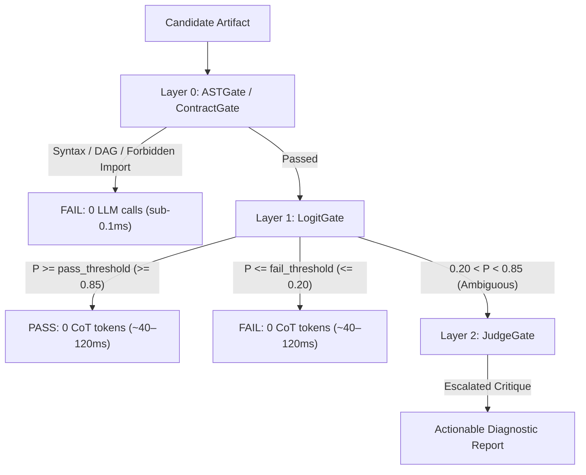

# 3-Layer Cascaded Router Architecture & Deployment Topologies

This document provides a comprehensive architectural breakdown of the **LogitGate** evaluation pipeline, its execution mechanics, short-circuiting rules, and production deployment topologies.

---

## 3-Layer Cascaded Router Architecture

### Layer Execution Breakdown

1. **Layer 0 (`ASTGate` / `ContractGate`)**:
   - **Latency**: Sub-millisecond (~0.04 ms on CPU).
   - **Cost**: Zero LLM calls, zero tokens, zero GPU memory.
   - **Mechanics**: Deterministically verifies structural contracts before any neural network invocation:
     - Python AST syntax trees (`syntax=True`).
     - Forbidden imports (`forbidden_imports=["os", "sys", "subprocess"]`).
     - Forbidden regex patterns (`forbidden_patterns`).
     - Required document sections (`required_sections`).
     - Character length bounds (`min_length`, `max_length`).
     - Pydantic models & JSON Schemas (`json_schema`).
     - Task dependency acyclic DAG cycles (`acyclic_dag=True`).
     - Arbitrary user-defined callables (`validators`).
   - If an artifact fails Layer 0, the pipeline halts immediately with `passed=False` and `status=DecisionStatus.FAILED`.

2. **Layer 1 (`LogitGate` / `ChoiceGate` / `ScoreGate`)**:
   - **Latency**: ~36–41 ms (single-pass GPU), ~90–113 ms (2-pass debiased GPU), ~170–640 ms (CPU).
   - **Output Tokens**: **0 autoregressive Chain-of-Thought tokens**.
   - **Mechanics**: Reads the model's raw first-token log-probabilities (`max_tokens=1`) under greedy decoding.
     - **Binary Pass/Fail (`LogitGate`)**: Runs forward ($A=\text{Pass}, B=\text{Fail}$) and reverse ($B=\text{Pass}, A=\text{Fail}$) passes to cancel pretraining token priors and positional bias, abstaining (`DecisionStatus.AMBIGUOUS`) inside `fail_threshold < P < pass_threshold`, when target tokens are unobserved, or when `max_positional_bias` sign-flip divergence is exceeded.
     - **Discrete K-ary Selection (`ChoiceGate`)**: Normalizes probabilities across $K$ options using forward and reverse permutation averaging (`derangement`, `cyclic`, or `reverse`), supporting selective `AMBIGUOUS` abstention on unobserved target tokens (`choice=None`), `min_confidence`, or `min_margin` (`top2_margin`) so low-confidence routes can escalate to Layer 2.
     - **Continuous Scoring (`ScoreGate`)**: Computes probability-weighted expected scores ($\mathbb{E}[S] = \sum s \cdot P(s)$) over discrete anchors (1 to 5) with scale reversal, supporting selective `AMBIGUOUS` abstention on unobserved target tokens (`score=None`), uncertainty band `fail_threshold < E[S] < threshold`, or bimodal dispersion `score_std > max_score_std`.
     - **Thinking Prefill Suppression & Warm Prefixing**: Layer-1 backends automatically suppress reasoning prefill tokens (`OllamaBackend` sends `think=False` with legacy HTTP 400 opt-out; `OpenAICompatBackend` sends `reasoning_effort="none"` with sticky HTTP 400/422 opt-out and automatic `chat_template_kwargs={"enable_thinking": False}` fallback on `<think>`/`<|thought|>`/empty traps plus optional `auto_logit_bias=True`; `LlamaCppBackend` supports `chat_template_kwargs` and Mode-A `auto_logit_bias=True`). Async 2-pass backends that prefer cold-prefix cache warmup (`OllamaBackend`, `LlamaCppBackend`) run Pass 1 sequentially before Pass 2 by default (configurable via `warm_prefix`).
   - **Short-Circuiting Rules**:
     - If calibrated confidence $P \ge \text{pass\_threshold}$ (default: $0.85$), it issues an immediate **Fast-Path PASS**, bypassing the following Layer-2 gate (unless that gate's policy is `always`).
     - If confidence $P \le \text{fail\_threshold}$ (default: $0.20$) and downstream `JudgeGate` is configured with `trigger="on_ambiguous_only"`, it issues an immediate **Decisive FAIL**, short-circuiting Layer 2.

> **Routing is trait-based.** `Cascade` never checks concrete classes. Each gate declares `layer_tier` (0 deterministic, 1 logit, 2 generative), `can_fast_path`, and, on tier-2 gates, `escalation_policy`. Tier-0 failures are final. A tier-1 failure or ambiguity defers to an immediately following tier-2 gate, whose policy decides whether it runs. Custom gates, wrappers, and decorators that declare these traits route exactly like the built-ins. The sync and async paths share one generator-based pipeline (`Cascade._pipeline`), so routing behavior is identical between `evaluate` and `aevaluate` by construction.

3. **Layer 2 (`JudgeGate`)**:
   - **Latency**: 1,500–5,000 ms (generative autoregressive decoding).
   - **Trigger Policies**:
     - `on_ambiguous_only` (default): Executes ONLY when Layer 1 confidence is genuinely ambiguous ($0.20 < P < 0.85$). Clean passes and decisive failures bypass Layer 2.
     - `on_ambiguous_or_fail`: Executes if Layer 1 was ambiguous ($0.20 < P < 0.85$) OR if Layer 1 failed, providing actionable diagnostic feedback.
     - `adjudicate`: Escalates both ambiguous items AND Layer-1 semantic failures while allowing Tier-2 `JudgeGate` to overturn Tier-1 false-negative failures (deterministic Tier-0 `ASTGate` failures remain final).
     - `always`: Forces generative critique on every artifact regardless of upstream confidence.
   - **Monotonic Failure Preservation**:
     - Under `on_ambiguous_or_fail`, when Layer 1 decisively fails ($P \le \text{fail\_threshold}$) and escalates to Layer 2 for diagnostic reporting, the final Verdict preserves `passed=False` even if the downstream generative judge's text critique phrasing is lenient.
   - **Post-Critique Logit Adjudication & Prior-Evidence Fusion**:
     - When backed by a `LogitBackend`, `JudgeGate` performs symmetric 2-pass post-critique `A/B` log-odds adjudication over its verification notes, and `Cascade(..., fuse_logits=True, prior_weight=0.30)` fuses permutation-consistent Layer-1 priors ($|z_1| \ge 1.0$) with uncertain split Layer-2 critiques ($|z_2| < 1.0$) before falling back to structured `[VERDICT: ...]` tags or the self-healing 1-token `_probe()`.
     - If tags are omitted, `JudgeGate` runs its self-healing 1-token `LogitGate` probe on the generated critique text before heuristic fallback.

---

## System Requirements & Hardware Tiers

`LogitGate` adapts dynamically across hardware environments:

| Hardware Tier | Recommended Model | Backend Specifier / Config | Typical Single-Pass Latency | Target Workflows |
| :--- | :--- | :--- | :--- | :--- |
| **0-GPU CI Runners / Air-Gapped** | Offline Deterministic Stub | `stub://default` | **< 0.05 ms** | Unit tests, mock suites, CI smoke tests |
| **CPU-Only Laptops / Edge** | `qwen2.5-coder:3b` / `llama3.2:3b` / `gemma4:e4b` | `ollama://localhost:11434/qwen2.5-coder:3b` (`options={"num_gpu": 0}`) | **~64–170 ms** (`2.1 GB` RAM on 3B) | Local developer testing & CPU CI without discrete GPU |
| **8–12 GB VRAM Consumer GPU** | `qwen2.5:7b` / `gemma4:e4b` | `ollama://localhost:11434/gemma4:e4b` | **~40–45 ms** | Desktop development, real-time agent loops |
| **16–24 GB VRAM Workstation** | `qwen2.5-coder:14b` / `qwen2.5:14b` | `ollama://localhost:11434/qwen2.5-coder:14b` | **~40–50 ms** | Production evaluation suites, coding agents |
| **Cloud Inference / Hosted APIs** | `gpt-4o-mini` / `vLLM` | `openai://api.openai.com/v1` or `vllm://localhost:8000/v1` | **~60–120 ms** (network bounded) | High-concurrency enterprise pipelines |

---

## 3 Deployment Topologies: Preventing KV-Cache Eviction & Thrashing

When deploying LLM evaluation pipelines, a common production failure mode is **KV-Cache Thrashing**: when a primary generation model (e.g., an agent synthesizing code) is interrupted by an evaluation judge loading into the same VRAM or context window, evicting the primary generator's KV-cache and forcing expensive full recomputation.

`LogitGate` supports three deployment topologies designed to prevent cache eviction:

### Topology 1: Single-Model Shared KV-Cache (Batch Evaluation Suites)
- **Use Case**: Evaluating multiple rubrics on the same candidate artifact.
- **Mechanics**: Using `MultiRubricGate` (or `evaluate_batch(candidate, rubrics)`), the candidate tokens are evaluated once at the root of the prompt. Subsequent rubric logit probes reuse the shared `[CANDIDATE ARTIFACT]` prompt prefix in the KV-cache without evicting the context, reducing per-rubric latency to ~110 ms on GPU and ~450–925 ms on CPU. Setting `fail_fast=True` short-circuits remaining rubrics as soon as any rubric produces `DecisionStatus.FAILED`, saving **40%–80%** of backend calls on defective artifacts, while `warm_prefix` runs Pass 1 ahead of Pass 2 in async evaluation to avoid cold-prefill slot races on single-node servers.

### Topology 2: Heterogeneous Dual-GPU Sidecar (High-Throughput Production)
- **GPU 0**: Pinned exclusively to the primary generator model (e.g., `gemma4:26b` MoE or `gemma4:31b` Dense) with 16k–32k context. Its generation KV-cache is **never evicted**.
- **GPU 1**: Dedicated to a lightweight `LogitGate` sidecar (`qwen2.5:14b` or `gemma4:e4b` in ~8.7–9.4 GB VRAM, or `llama3.2:3b` in ~3.2 GB VRAM).
- **Latency & Throughput**: Real-time gating queries complete in ~40–50 ms (single-pass) or ~85–120 ms (2-pass symmetric) over local IPC (`http://localhost:11435`) without contending for GPU 0's memory bandwidth.

### Topology 3: Single-GPU Workstation + Pure-CPU `LogitGate` Sidecar (Memory-Constrained)
- **100% of GPU VRAM** is preserved for the primary generator model.
- **Layer 1 `LogitGate`** runs on the host CPU with `options={"num_gpu": 0, "num_ctx": 2048}` in ~170 ms (single-pass) using standard System RAM (~3.2 GB for 3B Q4 models like `qwen2.5:3b` / `llama3.2:3b`, or ~9.4 GB for `gemma4:e4b`).
- **Short-Circuiting**: Clear passes short-circuit without GPU VRAM interference. Only ambiguous items or failures escalate to the GPU-backed `JudgeGate`.
