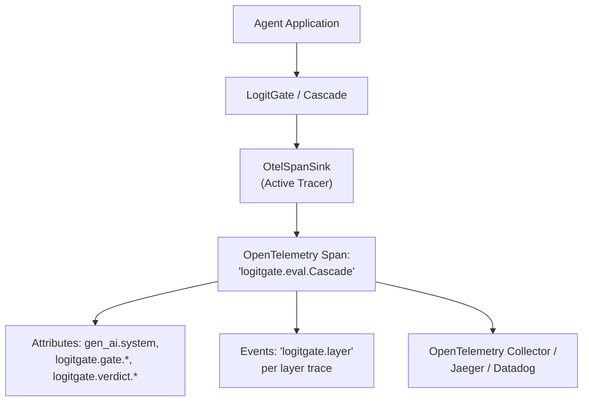

[🏠 README](../README.md) · [📚 Docs Hub](./README.md) · [⚡ Quick Notes](./quick/quickstart_recipes.md) · [🔬 Deep Architecture](./architecture.md) · [🧭 Visual Guide](./eli5/how_logitgate_works.md) · [🚀 Power-User](./advanced/distillation_and_lora.md) · [📊 Benchmarks](./benchmarks.md)

# Framework Integrations & Ecosystem Adapters

This document details the native framework integrations, testing hooks, agent routing adapters, and observability bridges supported in **LogitGate**. For introductory recipes, see [Quickstart Recipes](./quick/quickstart_recipes.md); for mathematical derivations, see [Mathematical Foundations](./math_and_debiasing.md).

---

## 1. Pytest Integration (`@check`)

LogitGate provides a native pytest decorator (`@check`) registered via the `pytest11` entrypoint to assert that test return values satisfy natural-language rubrics without custom regexes or multi-second generative LLM critiques.

### 1. Minimal Synchronous `@check`

```python
from logitgate import check

@check("Reply apologizes for the duplicate charge and confirms a full refund.")
def test_refund_reply():
    return "Sorry for the duplicate charge. We have issued a full refund to your card."
```

### 2. Grounded RAG, Async Coroutines & Failure Snapshots

```python
import pytest
from logitgate import check

# 1. Grounded RAG Check on an Async Function with Failure Snapshots
@pytest.mark.asyncio
@check(
    rubric="Summary accurately reflects the reference context without unasserted claims.",
    threshold=0.85,
    context="LogitGate v0.15.0 features ToolCallGate for agent security and GeminiBackend for Google Gemini.",
    query="What new capabilities shipped in LogitGate v0.15.0?",
    save_snapshot=True,
)
async def test_async_rag_summary():
    return "LogitGate v0.15.0 includes ToolCallGate and GeminiBackend."

# 2. Multi-Choice Intent Classification Check
@check(
    rubric="Select the category that best describes the customer inquiry.",
    choices={
        "A": "Billing and invoicing questions",
        "B": "Technical bug report",
        "C": "Feature request",
    },
    pass_choices=["A"],
    min_confidence=0.80,
)
def test_support_classification():
    return "How do I update my credit card on file for next month's subscription invoice?"

# 3. Multi-Rubric Code Quality Check
@check(
    rubrics=[
        "Function includes complete Python type hints.",
        "Function contains no hardcoded credentials or API keys.",
        "Function handles negative numbers by raising ValueError.",
    ],
    aggregation="all",
    threshold=0.80,
)
def test_secure_math_helper():
    return (
        "def square_root(x: float) -> float:\n"
        "    if x < 0:\n"
        "        raise ValueError('x cannot be negative')\n"
        "    return x ** 0.5\n"
    )
```

### 3. Running `pytest` from the CLI

```bash
# Run pytest against a live local Ollama model and freeze failure snapshots
pytest --logitgate-backend ollama://localhost:11434/qwen2.5-coder:14b --logitgate-save-failures

# Or run in air-gapped CI using the offline deterministic stub (0 GPU, <0.05 ms)
pytest --logitgate-backend stub://
LOGITGATE_BACKEND=stub:// pytest
```

### 4. Key `@check` Parameters & Capabilities

- **Sync and Async Test Functions**: Wraps standard `def` tests and `@pytest.mark.asyncio` coroutines without boilerplate runners.
- **Grounded Verification (`context` & `query`)**: Validates answers against retrieved documents and user queries using nonce-bounded prompt slots.
- **Categorical Routing (`choices` & `pass_choices`)**: Asserts that an artifact maps to approved discrete options via `ChoiceGate`.
- **Ordinal Scoring (`score_range` & `score_threshold`)**: Enforces continuous score expectations (e.g., `(1, 5)`) via `ScoreGate`.
- **Multi-Rubric Verification (`rubrics` & `aggregation`)**: Asserts compliance across atomic criteria (`"all"`, `"any"`, or `"mean"`).
- **Capability-Aware Sidecar Routing (`on_unsupported_logprobs="sidecar"`)**: Routes Layer-1 checks to `sidecar_backend` when primary endpoints omit logprobs.
- **Deterministic Failure Snapshots (`save_snapshot=True` or `--logitgate-save-failures`)**: Persists failed evaluations to `.logitgate/failures/` for offline inspection via `logitgate explain`.

---

## 2. DeepEval Integration (`LogitGateSystemOneModel` & `LogitGateMetric`)

LogitGate integrates natively with the DeepEval evaluation framework:

### A. High-Speed System-1 Judge Model (`LogitGateSystemOneModel`)

LLM evaluation suites running hundreds of test cases incur multi-second latency and high token bills when backed by generative judges. `LogitGateSystemOneModel` acts as a drop-in System-1 (single-pass, zero-generation) judge for DeepEval's `JevEval` metrics (Deußer et al., 2026), evaluating each `LLMTestCase` (`input`, `actual_output`) in **36-90 ms** with **0 generated CoT tokens** using raw first-token logprobs.

`LogitGateSystemOneModel` supports all three DeepEval System-1 schemas:
- **`NoulQuestion`**: Evaluates binary statements, returning `NoulAnswer(probability=...)`.
- **`ChoiceQuestion`**: Normalizes categorical selections across options, returning `ChoiceAnswer(choice=..., confidence=...)`.
- **`ScoreQuestion`**: Calculates probability-weighted expected scores, returning `ScoreAnswer(score=..., confidence=...)`.

```python
from deepeval.metrics import JevEval
from deepeval.metrics.jev_eval import Noul
from deepeval.test_case import LLMTestCase, LLMTestCaseParams
from logitgate.integrations.deepeval import LogitGateSystemOneModel

# 1. Instantiate System-1 Judge backed by local model
system_one = LogitGateSystemOneModel(
    model_name="qwen2.5-coder:14b",
    api_base="http://localhost:11434",
    symmetric=True,  # Full 2-pass symmetric debiasing
)

# 2. Build DeepEval JevEval metric
metric = JevEval(
    name="Security Baseline Check",
    questions=[
        Noul(statement="Artifact does not invoke raw shell commands"),
        Noul(statement="Artifact does not read sensitive filesystem paths"),
    ],
    evaluation_params=[LLMTestCaseParams.ACTUAL_OUTPUT],
    system_one_model=system_one,
)

test_case = LLMTestCase(
    input="Execute security audit",
    actual_output="def check(): pass",
)

metric.measure(test_case)
print(f"JevEval Score: {metric.score}, Successful: {metric.is_successful()}")
```

### B. Standalone DeepEval Metric (`LogitGateMetric`)

`LogitGateMetric` allows any `LLMTestCase` to be evaluated against calibrated rubrics directly within standard DeepEval test runners. It accepts `fail_threshold`, `preset`, and `logit_temperature`, and its `is_successful()` method correctly handles gate abstentions (`AMBIGUOUS` maps to `False`):

```python
from deepeval.test_case import LLMTestCase
from logitgate.integrations.deepeval import LogitGateMetric

# Create fast LogitGate evaluation metric
metric = LogitGateMetric(
    rubric="Response accurately answers the user query without making unverified claims.",
    threshold=0.85,
    preset="balanced",
)

test_case = LLMTestCase(
    input="When was the company founded?",
    actual_output="The company was founded in 2021 by a team of researchers.",
)

metric.measure(test_case)
print(f"Confidence Score: {metric.score:.3f}, Passed: {metric.is_successful()}")
```

---

## 3. LangGraph Multi-Agent Routing (`as_conditional_edge` & `as_async_conditional_edge`)

In multi-agent systems and state graphs (LangGraph, AutoGen), conditional routing traditionally requires an LLM to generate structured JSON text, introducing 2-5 seconds of decode latency per routing step.

LogitGate's `as_conditional_edge` and `as_async_conditional_edge` convert any `LogitGate` or `ChoiceGate` into a **sub-50 ms routing edge** (0 generated tokens), extracting the target field via `state_key` and routing uncertain `AMBIGUOUS` states to `ambiguous_node` instead of forcing an arbitrary branch.

### Universal State Polymorphism

LogitGate's edge adapters extract target artifacts polymorphically across:
1. Standard Python dictionaries and `TypedDict` mappings (`state["content"]`).
2. Pydantic `BaseModel` instances (`state.content`).
3. Standard library `@dataclass` state objects (`state.content`).

```python
from typing import TypedDict
from langgraph.graph import StateGraph
from logitgate import ChoiceGate, LogitGate
from logitgate.backends import OllamaBackend
from logitgate.integrations.langgraph import as_async_conditional_edge, as_conditional_edge

backend = OllamaBackend(model="qwen2.5-coder:14b")

class AgentState(TypedDict):
    content: str
    user_id: str

# 1. Binary Safety & Escalation Edge (3-way routing)
safety_gate = LogitGate(
    rubric="Is the generated assistant response safe, appropriate, and grounded?",
    pass_threshold=0.85,
    fail_threshold=0.20,
    backend=backend,
)

route_safety = as_conditional_edge(
    safety_gate,
    pass_node="publish_to_user",
    fail_node="redraft_response",
    ambiguous_node="human_supervision",  # Escalates uncertain responses to human queue
    state_key="content",
)

# 2. Categorical Intent Routing Edge (K-way routing)
intent_router = ChoiceGate(
    question="Select the specialized agent best suited to answer this request:",
    options={
        "A": "Database Query Agent (SQL generation and analytics)",
        "B": "Account & Authentication Agent (passwords, tokens, credentials)",
        "C": "General Customer Support Agent",
    },
    backend=backend,
)

route_intent = as_async_conditional_edge(
    intent_router,
    node_mapping={
        "A": "db_agent_node",
        "B": "auth_agent_node",
        "C": "support_agent_node",
    },
    state_key="content",
)

# Assemble state graph
workflow = StateGraph(AgentState)
workflow.add_conditional_edges("triage", route_intent)
workflow.add_conditional_edges("draft_generator", route_safety)
```

---

## 4. OpenTelemetry Distributed Tracing (`OtelSpanSink`)

Production deployments require deep distributed tracing to monitor fast-path hit rates, Layer-1 student vs. Layer-2 teacher disagreements, and latency bottlenecks without manual instrumentation.

`OtelSpanSink` (`pip install 'logitgate[otel]'`) provides a low-overhead bridge to OpenTelemetry:



- **Standard Semantic Conventions**: Populates `gen_ai.system`, `gen_ai.request.model`, `logitgate.gate.name`, `logitgate.verdict.passed`, `logitgate.verdict.probability`, `logitgate.verdict.latency_ms`.
- **Per-Layer Span Events**: Records individual layer executions as child span events (`record_layer_events=True`), detailing Layer 0, Layer 1, and Layer 2 transitions.
- **Privacy Controls**: Defaults to `privacy="omit_candidate"`, ensuring candidate texts and generative critique strings are never persisted in trace backends.
- **Zero-Dependency Fallback**: If `opentelemetry-api` is not installed, `OtelSpanSink` falls back to a no-op (`is_enabled == False`).

```python
from logitgate import Cascade, JudgeGate, LogitGate
from logitgate.backends import OllamaBackend
from logitgate.telemetry import OtelSpanSink

# Initialize OpenTelemetry span sink
otel_sink = OtelSpanSink(
    instrumentation_name="agent-eval-service",
    record_layer_events=True,
    error_on_fail=False,
    privacy="omit_candidate",  # Omits raw candidate text from span attributes
)

backend = OllamaBackend(model="qwen2.5-coder:14b")

with Cascade(
    [
        LogitGate("Code contains complete type hints.", backend=backend),
        JudgeGate(trigger="on_ambiguous_only", backend=backend),
    ],
    telemetry_sink=otel_sink,
) as traced_pipeline:
    verdict = traced_pipeline.evaluate("def add(a: int, b: int) -> int: return a + b")
    print(f"Evaluated and traced: {verdict.passed}")
```

---

## 5. Model Context Protocol (MCP) & OpenAI Tool Sandboxing (`ToolCallGate`)

When building autonomous agents using Anthropic's Model Context Protocol (MCP) or OpenAI function calling, tools frequently execute system commands, filesystem queries, or database modifications.

`ToolCallGate` inspects tool-call payloads before execution, separating the untrusted `candidate` JSON-RPC/tool dict from the trusted `user_intent`. Stage-0 deterministic defenses (SSRF, path traversal, destructive SQL/shell) block structural attacks in **~0.08 ms p50 with 0 LLM calls**, while optional Stage-1 intent alignment (`check_intent=True`) verifies semantic compliance in **~45 ms**:

```python
from logitgate import ToolCallGate
from logitgate.backends import OllamaBackend

backend = OllamaBackend(model="qwen2.5-coder:14b")

# Configure ToolCallGate for MCP tools
mcp_shield = ToolCallGate(
    allowed_tools=["read_file", "search_directory", "query_db"],
    allowed_roots=["/var/data/workspace"],
    block_path_traversal=True,
    block_ssrf=True,
    block_destructive_commands=True,
    block_destructive_sql=True,
    check_intent=True,
    user_intent="Read application configuration file config.yaml",
    backend=backend,
)

# 1. MCP JSON-RPC tool-call envelope
mcp_call = {
    "jsonrpc": "2.0",
    "method": "tools/call",
    "params": {
        "name": "read_file",
        "arguments": {"path": "/var/data/workspace/config.yaml"},
    },
    "id": 1,
}
verdict = mcp_shield.evaluate(mcp_call)
assert verdict.passed, "Legitimate MCP call failed!"

# 2. Path Traversal Attack: Blocked in ~0.08ms p50 at Stage 0
traversal_call = {
    "jsonrpc": "2.0",
    "method": "tools/call",
    "params": {
        "name": "read_file",
        "arguments": {"path": "/var/data/workspace/../../etc/shadow"},
    },
    "id": 2,
}
attack_verdict = mcp_shield.evaluate(traversal_call)
assert not attack_verdict.passed
print(f"Attack Blocked: {attack_verdict.reason}")
```

---

## 6. Bring-Your-Own (BYO) Syntactic & Schema Validators (`ASTGate`)

`ASTGate` acts as a Layer-0 (**<0.1 ms, 0 LLM calls**, `can_fast_path = False`) adapter between your pipeline and Python's parsing ecosystem, eliminating malformed JSON/code before paying GPU prefill or judge costs.

When initialized with `normalize=True`, `ASTGate` automatically strips conversational preamble, reasoning tags (`<think>...</think>`), and markdown fences (` ```python ... ``` `) before running structural validators:

```python
import ast
from pydantic import BaseModel, Field
from logitgate import ASTGate, Cascade, JudgeGate, LogitGate

class DatabaseMigrationPayload(BaseModel):
    table_name: str
    column_name: str
    data_type: str
    is_nullable: bool = Field(default=True)

# Cascade combining Layer 0 schema validation with Layer 1 security check
pipeline = (
    ASTGate(DatabaseMigrationPayload, normalize=True)
    >> LogitGate("Does the migration follow naming conventions and avoid reserved keywords?")
    >> JudgeGate(trigger="on_ambiguous_only")
)

raw_agent_output = (
    "<think>\nNeed to add a created_at timestamp to user table.\n</think>\n"
    "Here is the requested schema definition:\n"
    "```json\n"
    '{"table_name": "users", "column_name": "created_at", "data_type": "TIMESTAMP", "is_nullable": false}\n'
    "```\n"
)

verdict = pipeline.evaluate(raw_agent_output)
assert verdict.passed
print(f"Migration Schema Approved at Layer: {verdict.triggered_layer}")
```

---

[🏠 README](../README.md) · [📚 Docs Hub](./README.md) · [⚡ Quick Notes](./quick/quickstart_recipes.md) · [🔬 Deep Architecture](./architecture.md) · [🧭 Visual Guide](./eli5/how_logitgate_works.md) · [🚀 Power-User](./advanced/distillation_and_lora.md) · [📊 Benchmarks](./benchmarks.md)
