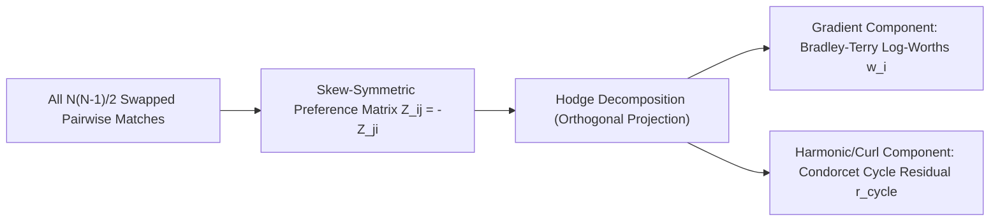

[🏠 README](../README.md) · [📚 Docs Hub](./README.md) · [⚡ Quick Notes](./quick/quickstart_recipes.md) · [🧭 Visual Guide](./eli5/how_logitgate_works.md) · [🚀 Power-User](./advanced/distillation_and_lora.md) · [📊 Benchmarks](./benchmarks.md)

# Deep Notes: Mathematical & Statistical Foundations

This document provides the formal mathematical derivations, statistical proofs, and numerical invariants underpinning **LogitGate**. It covers symmetric log-odds debiasing, BPE surface-variant marginalization, fixed-point-free permutations, combinatorial Hodge ranking, and distribution-free split-conformal risk control.

---

## 1. Symmetric Log-Odds Permutation Debiasing

Large language models exhibit two pervasive statistical biases when acting as zero-shot evaluators (Zhao et al., 2021; Zheng et al., 2023):
1. **Pretraining Token Prior Bias ($b_{\text{tok}}$)**: Unconditioned preference for specific token IDs (e.g. favoring token `'A'` over `'B'` due to corpus frequency).
2. **Positional Slot Bias ($b_{\text{pos}}$)**: Recency or primacy preference for options positioned earlier in the prompt text.



### Formal Proof of Exact Additive Bias Cancellation

Let $s \in \mathbb{R}$ represent the true latent log-odds alignment signal of candidate artifact $x$ with respect to evaluation rubric $R$.
Let $b = b_{\text{tok}} + b_{\text{pos}} \in \mathbb{R}$ represent the combined additive nuisance bias favoring option slot `'A'`.

We construct two complementary evaluation passes:

- **Pass 1 (Forward Mapping: $A = \text{Pass}, B = \text{Fail}$)**:
  The observed logits for tokens $A$ and $B$ under prompt context $\mathcal{C}_1$ are:
  $$\text{logit}_1(A) = s_{\text{pass}} + b_A, \qquad \text{logit}_1(B) = s_{\text{fail}} + b_B$$
  The forward log-odds $L_1$ is:
  $$L_1 = \text{logit}_1(A) - \text{logit}_1(B) = (s_{\text{pass}} - s_{\text{fail}}) + (b_A - b_B) = s + b$$

- **Pass 2 (Reverse Mapping: $B = \text{Pass}, A = \text{Fail}$)**:
  The evaluation semantics are inverted: slot $B$ now denotes Pass, and slot $A$ denotes Fail. Under prompt context $\mathcal{C}_2$:
  $$\text{logit}_2(B) = s_{\text{pass}} + b_B, \qquad \text{logit}_2(A) = s_{\text{fail}} + b_A$$
  The reverse log-odds $L_2$ relative to the Pass hypothesis is:
  $$L_2 = \text{logit}_2(B) - \text{logit}_2(A) = (s_{\text{pass}} - s_{\text{fail}}) - (b_A - b_B) = s - b$$

LogitGate pools the forward and reverse passes in **log-odds space**, scaled by an empirical post-hoc temperature parameter $T > 0$:

$$\bar{L} = \frac{L_1 + L_2}{2 \cdot T} = \frac{(s + b) + (s - b)}{2 \cdot T} = \frac{2s}{2T} = \frac{s}{T}$$

The additive nuisance bias $b$ cancels out analytically:

$$\lim_{b \to \infty} \left( \frac{(s + b) + (s - b)}{2T} \right) = \frac{s}{T}$$

The calibrated probability of passing is computed via the standard logistic sigmoid:

$$P(\text{Pass}) = \sigma(\bar{L}) = \frac{1}{1 + e^{-\bar{L}}}$$

<details>
<summary>💡 <b>Weighing twice on an uneven balance scale</b></summary>
<blockquote>
Imagine a two-pan balance scale whose left arm is slightly heavier than its right arm, adding an unknown `+5` gram tilt to whatever sits on the left pan.

To weigh an object whose true advantage is `+2` grams despite that `+5` scale defect:
1. **Pass 1 (Object on Left Pan / Option A)**: The scale reads `2 + 5 = +7`.
2. **Pass 2 (Object on Right Pan / Option B)**: You swap the two sides. The scale still tilts toward the left pan, so relative to your object it now reads `2 - 5 = -3`.

Either single pass gives a skewed number (`+7` or `-3`), but averaging the two readings cancels the uneven arm completely: `(+7 + (-3)) / 2 = +2`, recovering the true weight without needing to measure the scale's defect ahead of time.
</blockquote>
</details>

**Operational Impact (Why This Matters in Production):** Without symmetric swap debiasing, compact 3B-14B models commonly exhibit `15-35 pp` label or slot preference (e.g., favoring `'A'` regardless of content). On a security or RAG gate, that bias silently shifts your effective threshold, causing unacceptable false-pass rates or false-reject storms whenever rubric phrasing changes.

---

### Jensen's Inequality & The Failure of Naive Probability Averaging

Many naive LLM evaluation harnesses attempt to debias models by computing the probability on Pass 1 ($P_1 = \sigma(L_1)$), the probability on Pass 2 ($P_2 = \sigma(L_2)$), and taking their arithmetic mean:

$$\bar{P}_{\text{naive}} = \frac{P_1 + P_2}{2} = \frac{\sigma(s + b) + \sigma(s - b)}{2}$$

By **Jensen's inequality**, for any non-linear function $f$, $\mathbb{E}[f(X)] \ne f(\mathbb{E}[X])$. The logistic function $\sigma(z) = \frac{1}{1 + e^{-z}}$ is strictly convex for $z < 0$ and strictly concave for $z > 0$, with inflection point at $z = 0$.

Under strong token prior or positional bias ($|b| \gg 0$), naive probability averaging causes **saturation collapse**:

$$\lim_{b \to \infty} \sigma(s + b) = 1.0, \qquad \lim_{b \to \infty} \sigma(s - b) = 0.0$$
$$\lim_{b \to \infty} \bar{P}_{\text{naive}} = \frac{1.0 + 0.0}{2} = \mathbf{0.50} \quad (\text{Coin Flip / False Ambiguity})$$

Whether the true latent signal $s$ is $+10.0$ (clean code) or $-10.0$ (blatant security defect), naive probability averaging collapses toward $0.50$. In production cascades, that false ambiguity forces clear passes and clear fails to escalate unnecessarily to Layer-2 generative judges, erasing latency and cost savings. In contrast, LogitGate's log-odds combination preserves linear additivity across the entire real number line:

```python
import math

def sigmoid(z: float) -> float:
    return 1.0 / (1.0 + math.exp(-z))

# Scenario: True positive signal s = +2.0 (True P = 88.08%)
# Contaminated by extreme prior bias b = +5.0
s = 2.0
b = 5.0

L1 = s + b   # 7.0
L2 = s - b   # -3.0

# 1. Naive Probability Averaging
p1 = sigmoid(L1)  # 0.99908
p2 = sigmoid(L2)  # 0.04743
p_naive = (p1 + p2) / 2.0  # 0.52325 (False Ambiguity!)

# 2. LogitGate Log-Odds Averaging
L_bar = (L1 + L2) / 2.0   # 2.0
p_logitgate = sigmoid(L_bar)  # 0.88080 (Exact True Signal Recovered!)

print(f"True Quality: {sigmoid(s):.4f}")
print(f"Naive Probability Averaging: {p_naive:.4f} (Distorted)")
print(f"LogitGate Log-Odds Space:   {p_logitgate:.4f} (Exact)")
```

---

## 2. BPE Surface-Variant Marginalization & Missing-Token Bounded Floor

In Byte-Pair Encoding (BPE) and SentencePiece tokenizers, a single semantic letter (e.g. `'A'`) is split across multiple discrete token IDs depending on preceding whitespace and punctuation:
- Target variants: `["A", " A", "\nA", "\tA", "A."]`

### Surface-Variant Log-Sum-Exp Aggregation

If an evaluator inspects only the exact string `"A"`, probability mass distributed across `" A"` or `"\nA"` is discarded, introducing severe artificial variance.

LogitGate extracts all observed surface variants for positive target tokens $\mathcal{V}_+$ and negative target tokens $\mathcal{V}_-$. For each variant set, it deduplicates token IDs, filters non-finite values (`NaN`, $\pm\infty$), clamps positive fast-math noise ($z > 0.0 \to 0.0$), and marginalizes in log-space via `logsumexp`:

$$\log P(\mathcal{V}) = \ln \sum_{v \in \mathcal{V}} \exp(\text{logprob}(v)) = \operatorname{logsumexp}_{v \in \mathcal{V}} \left( \text{logprob}(v) \right)$$

### Conservative Unobserved Probability Floor

Inference APIs (vLLM, Ollama, OpenAI) return top-$K$ log-probabilities ($K \in [5, 20]$). When a target decision token does not appear in the top-$K$ response, naive evaluators frequently assign an arbitrary constant such as $-99.0$ or $-100.0$. That creates artificial numerical cliffs in log-odds space ($\Delta L \approx 100$), turning a genuinely uncertain or malformed output into a false $0.0000$ or $1.0000$ certainty.

LogitGate analytically bounds missing tokens to the theoretical maximum residual probability mass unobserved by top-$K$:

Let $\{P_1, P_2, \dots, P_K\}$ denote the softmax probabilities of all tokens returned in the top-$K$ distribution. The maximum possible probability that any unobserved token could possess is bounded by the residual probability mass:

$$P_{\text{obs}} = \sum_{i=1}^K P_i, \qquad P_{\text{residual}} = \max\left(1.0 - P_{\text{obs}}, \, 10^{-6}\right)$$

The conservative bounded floor for any unobserved target token is:

$$\text{floor} = \min\left( \min_{i=1..K} \text{logprob}_i, \; \ln(P_{\text{residual}}) \right)$$

This guarantees that unobserved tokens are treated conservatively as having probability no greater than the least likely observed token or the remaining probability tail, preventing log-odds divergence.

**Operational Impact (Why BPE Marginalization & Abstention Matter):** Without surface-variant `logsumexp`, different chat templates (e.g., models emitting `" A"` with a leading space vs. `"A"`) drop silent probability mass, producing unpredictable score shifts across model upgrades. Without the `no_target_tokens` abstention invariant below, a reasoning model that emits `<think>` at Token 1 would default to $P = 0.50$ without warning instead of surfacing an explicit `AMBIGUOUS` escalation.

### Target-Token Abstention Invariant

If neither positive ($\mathcal{V}_+$) nor negative ($\mathcal{V}_-$) target tokens appear anywhere in the top-$K$ distribution on either pass:
- LogitGate refuses to assign a defaulted log-odds of $0.0$ ($P = 0.50$).
- The gate marks the evaluation as `DecisionStatus.AMBIGUOUS` with `metadata={"abstained_reason": "no_target_tokens"}`.
- The artifact is escalated to Layer 2 (`JudgeGate`) or surfaced for human inspection.

---

## 3. Discrete Categorical & Continuous Scoring Foundations

### `ChoiceGate`: Fixed-Point-Free Derangement Permutations

When selecting from $K \ge 3$ discrete options ($A, B, C, \dots$), naive permutation strategies fail:
- **Simple Reversal ($A \leftrightarrow C$)**: On odd $K$ (e.g. $K = 3$ or $K = 5$), reversing the list $(0, 1, 2) \to (2, 1, 0)$ leaves the center element $1$ pinned to its exact original slot ($1 \to 1$). The center option receives zero positional debiasing!

LogitGate implements a **fixed-point-free derangement permutation**:

$$\text{shift} = \max(1, \lfloor K / 2 \rfloor)$$
$$\pi(i) = (i + \text{shift}) \pmod K$$

Because $\gcd(\text{shift}, K)$ ensures that $\pi(i) \ne i$ for all $i \in \{0, \dots, K-1\}$, every option is guaranteed to move to a distinct slot in Pass 2.

The options are debiased by geometric pooling across permutations:
1. Centered log-probabilities are extracted for each option $k$:
   $$\tilde{\ell}^{(m)}_k = \log P_m(\pi_m(k)) - \frac{1}{K} \sum_{j=1}^K \log P_m(\pi_m(j))$$
2. Log-worths are averaged across forward and reverse passes:
   $$w_k = \frac{\tilde{\ell}^{(1)}_k + \tilde{\ell}^{(2)}_k}{2}$$
3. Calibrated choice probabilities are obtained via temperature-scaled softmax:
   $$P(k) = \frac{\exp(w_k / T)}{\sum_{j=1}^K \exp(w_j / T)}$$

### `ScoreGate`: Log-Linear Geometric Pooling

`ScoreGate` evaluates continuous quality by querying discrete ordinal anchors (e.g. scores $s \in \{1, 2, 3, 4, 5\}$).

- **The Pitfall of Direct Score Averaging**: Averaging forward and reverse expected scores directly ($0.5 \cdot (\mathbb{E}_{\text{fwd}} + \mathbb{E}_{\text{rev}})$) is mathematically invalid: it masks bimodal distributions and leaves token prior biases uncancelled in probability space.
- **LogitGate's Log-Linear Pooling**: LogitGate combines the forward ($1 \to 5$) and reverse ($5 \to 1$) passes in **log-probability space** (geometric mean) for each score anchor $s$:
  $$\log \bar{P}(s) = \frac{\log P_{\text{fwd}}(s) + \log P_{\text{rev}}(s)}{2} - \ln Z$$
  where $\ln Z = \operatorname{logsumexp}_{s} \left( \frac{\log P_{\text{fwd}}(s) + \log P_{\text{rev}}(s)}{2} \right)$ is the partition function.

The debiased continuous expected score is then computed as:

$$\mathbb{E}[S] = \sum_{s=1}^K s \cdot \bar{P}(s), \qquad \operatorname{Var}[S] = \sum_{s=1}^K (s - \mathbb{E}[S])^2 \cdot \bar{P}(s)$$

When the standard deviation $\sigma_S = \sqrt{\operatorname{Var}[S]}$ exceeds `max_score_std` (indicating high model discordance or a bimodal distribution), `ScoreGate` abstains with `DecisionStatus.AMBIGUOUS`.

**Operational Impact (Why Derangement & Variance Guardrails Matter):** In 3-way intent routing (`K=3`), simple list reversal leaves the middle route stuck in position 1 on both passes, biasing multi-agent dispatch toward or away from that route. Likewise, in 1-to-5 scoring, a candidate that splits the model `50%` at `1` and `50%` at `5` averages to `3.0`: without log-linear pooling and `max_score_std` abstention, a polarized failure looks indistinguishable from a mediocre pass.

---

## 4. Combinatorial Hodge Ranking & Condorcet Cycle Diagnostics (`RankGate`)

When comparing $N$ candidates, compact models exhibit severe pair-order bias. `RankGate` deploys combinatorial Hodge theory (Jiang et al., 2011) to decompose pairwise preferences into consistent rankings and non-transitive loops.



### Skew-Symmetric Preference Matrix

For every pair of candidates $(c_i, c_j)$, `RankGate` evaluates both presentations $(c_i, c_j)$ and $(c_j, c_i)$ with single-token logprobs:
$$Z_{ij} = \frac{\Delta^{(1)}_{ij} + \Delta^{(2)}_{ij}}{2}, \qquad Z_{ji} = -Z_{ij}, \qquad Z_{ii} = 0$$

### Bradley-Terry Log-Worth Projection

By the combinatorial Hodge decomposition, any skew-symmetric edge flow $Z \in \mathbb{R}^{N \times N}$ decomposes uniquely into orthogonal potential (gradient), cycle (curl), and harmonic components:

$$Z_{ij} = (w_i - w_j) + \Gamma_{ij}$$

The least-squares projection onto the zero-sum Bradley-Terry log-worth vector $w \in \mathbb{R}^N$ admits the exact closed-form solution:

$$w_i = \frac{1}{N} \sum_{j=1}^N Z_{ij}, \qquad \sum_{i=1}^N w_i = 0$$

### Condorcet Cycle Residual (Hodge Curl)

The orthogonal non-transitive component represents voting paradoxes or cyclical trade-offs ($A \succ B \succ C \succ A$). LogitGate quantifies this non-transitivity via the root-mean-square **cycle residual**:

$$r_{\text{cycle}} = \sqrt{\frac{1}{\binom{N}{2}} \sum_{1 \le i < j \le N} \left( Z_{ij} - (w_i - w_j) \right)^2}$$

- If $r_{\text{cycle}} \approx 0.0$: The candidate pool admits a globally consistent, transitive linear ordering.
- If $r_{\text{cycle}} \gg 0.0$: The candidates exhibit intransitive circular trade-offs, surfaced in trace metadata to alert agent orchestrators instead of silently breaking ties by input order.

---

## 5. Post-Hoc Temperature Calibration & Split-Conformal Risk Control



### Brier Score Minimization with Small-Sample MAP Prior

Softmax log-odds can be overconfident or underconfident depending on model scale. LogitGate fits an optimal scaling temperature $T^* > 0$ by minimizing the empirical Brier score over calibration set $\mathcal{D}_{\text{cal}} = \{(x_i, y_i)\}_{i=1}^N$, regularized by an uninformative prior that shrinks toward $T = 1.0$:

$$T^* = \arg\min_{T > 0} \left[ \frac{1}{N} \sum_{i=1}^N \left( \sigma\left( \frac{\bar{L}_i}{T} \right) - y_i \right)^2 + \frac{\lambda}{N} (T - 1.0)^2 \right]$$

### Finite-Sample Distribution-Free Split-Conformal Calibration

Setting operational thresholds independently of temperature induces scale drift. LogitGate's `fit_calibration_profile` employs **post-temperature split-conformal calibration** (Angelopoulos & Bates, 2021).

Let $p_i = \sigma(\bar{L}_i / T^*)$ denote the calibrated probabilities on calibration holdout $\mathcal{D}_{\text{cal}}$. For a target selective error rate $\alpha \in (0, 1)$:

1. **Accept Threshold ($\tau_{\text{accept}}$)**:
   We bound the False Accept Rate (Type I error on negative samples $y_i = 0$).
   Let $m_0 = |\{i : y_i = 0\}|$. We compute the nonconformity scores $e^{(0)}_i = p_i$.
   The conformal order statistic index is:
   $$k_0 = \left\lceil (m_0 + 1)(1 - \alpha/2) \right\rceil$$
   $$\tau_{\text{accept}} = \operatorname{strictly\_above}_4\left( e^{(0)}_{(k_0)} \right)$$

2. **Reject Threshold ($\tau_{\text{reject}}$)**:
   We bound the False Reject Rate (Type II error on positive samples $y_i = 1$).
   Let $m_1 = |\{i : y_i = 1\}|$. We compute nonconformity scores $e^{(1)}_i = 1 - p_i$.
   The conformal order statistic index is:
   $$k_1 = \left\lceil (m_1 + 1)(1 - \alpha/2) \right\rceil$$
   $$\tau_{\text{reject}} = \operatorname{strictly\_below}_4\left( 1 - e^{(1)}_{(k_1)} \right)$$

### Finite-Sample Coverage Guarantee

Provided deployment samples remain **exchangeable** with calibration holdout $\mathcal{D}_{\text{cal}}$, the probability that a fast-pathed decision errs is mathematically bounded:

$$\mathbb{P}\left(\hat{Y} \ne Y \mid P \ge \tau_{\text{accept}} \text{ or } P \le \tau_{\text{reject}}\right) \le \alpha$$

Any sample falling in the ambiguity band $\tau_{\text{reject}} < P < \tau_{\text{accept}}$ is safely escalated to Layer 2 (`JudgeGate`).

### Post-Temperature Monotone Rank Invariance

Because the temperature transform $z \mapsto \sigma(z / T^*)$ is strictly monotonic for any $T^* > 0$, the relative order of calibration points is invariant under scaling. Fitting temperature first on the full $2N$-pass log-odds sweep and subsequently setting conformal cutoffs directly on $p(T^*)$ preserves sample efficiency without requiring separate holdout splits.

**Operational Impact (Why Temperature + Conformal Bounds Matter):** Raw logit magnitudes vary substantially across model families and quantization levels (e.g., an 8B Q4 checkpoint vs. a 32B FP16 model). Without temperature scaling, a static `0.85` cutoff can be overly permissive on an overconfident checkpoint and overly conservative on an underconfident one. Combining Brier temperature fitting with split-conformal cutoffs replaces hand-tuned heuristic thresholds with an explicit, auditable error-rate target $\alpha$.

---

## 6. Statistical Benchmark & Evaluation Metrics

LogitGate implements strict, exact statistical evaluation functions in `logitgate.benchmarks` for pre-release verification:

### Wilson Score Confidence Interval with Continuity Correction

For observed success proportion $\hat{p} = k / n$ at confidence level $1 - \alpha$ ($z = \Phi^{-1}(1 - \alpha/2)$):

$$w = \frac{2n\hat{p} + z^2 \pm \left( z \sqrt{z^2 - \frac{1}{n} + 4n\hat{p}(1 - \hat{p}) + (4\hat{p} - 2)} + 1 \right)}{2(n + z^2)}$$

### McNemar's Exact Paired Test

To determine whether LogitGate significantly outperforms a baseline LLM judge on paired evaluations, LogitGate constructs the $2 \times 2$ contingency table of discordant pairs:
- $b$: Number of cases where LogitGate was correct and Baseline failed.
- $c$: Number of cases where Baseline was correct and LogitGate failed.

The exact two-sided $p$-value is computed from the binomial distribution:

$$p = 2 \sum_{k = \max(b, c)}^{b + c} \binom{b + c}{k} \left(\frac{1}{2}\right)^{b+c}$$

### Expected Calibration Error (ECE)

Using $M = 10$ equal-width probability bins $B_m \subset (0, 1]$:

$$\text{ECE} = \sum_{m=1}^M \frac{|B_m|}{N} \left| \operatorname{acc}(B_m) - \operatorname{conf}(B_m) \right|$$

where $\operatorname{conf}(B_m) = \frac{1}{|B_m|} \sum_{i \in B_m} p_i$ and $\operatorname{acc}(B_m) = \frac{1}{|B_m|} \sum_{i \in B_m} y_i$.

### AUROC & AURC

- **AUROC (Area Under ROC Curve)**: Computed via the Mann-Whitney $U$ statistic:
  $$\text{AUROC} = \frac{\sum_{i \in \mathcal{D}_1} \sum_{j \in \mathcal{D}_0} \mathbb{I}(p_i > p_j) + 0.5 \cdot \mathbb{I}(p_i = p_j)}{|\mathcal{D}_1| \cdot |\mathcal{D}_0|}$$
- **AURC (Area Under Risk-Coverage Curve)**: Evaluates selective risk as a function of coverage when abstaining on samples falling within $[\tau_{\text{reject}}, \tau_{\text{accept}}]$, quantifying the efficiency of Layer-1 short-circuiting.

---

## 7. Python Verification & Experimentation Suite

The following standalone script numerically validates bias cancellation, Jensen's inequality divergence, and conformal quantile calculation:

```python
import math

def verify_math_foundations() -> None:
    # 1. Verify Bias Cancellation
    true_signal = 1.85
    token_bias = 4.20
    temperature = 1.0

    L_fwd = true_signal + token_bias
    L_rev = true_signal - token_bias
    L_debiased = (L_fwd + L_rev) / (2.0 * temperature)
    assert abs(L_debiased - true_signal) < 1e-12, "Bias cancellation failed!"

    # 2. Verify Jensen Inequality Divergence
    def sig(x: float) -> float:
        return 1.0 / (1.0 + math.exp(-x))

    p_naive = 0.5 * (sig(L_fwd) + sig(L_rev))
    p_true = sig(true_signal)
    distortion = abs(p_naive - p_true)
    assert distortion > 0.30, "Jensen divergence should be pronounced under heavy bias!"

    # 3. Verify Conformal Quantile Index
    n_samples = 100
    alpha = 0.10  # 90% coverage
    order_idx = math.ceil((n_samples + 1) * (1.0 - alpha))
    assert order_idx == 91, f"Expected index 91, got {order_idx}"

    print("All mathematical foundations verified successfully!")

if __name__ == "__main__":
    verify_math_foundations()
```

---

[🏠 README](../README.md) · [📚 Docs Hub](./README.md) · [⚡ Quick Notes](./quick/quickstart_recipes.md) · [🧭 Visual Guide](./eli5/how_logitgate_works.md) · [🚀 Power-User](./advanced/distillation_and_lora.md) · [📊 Benchmarks](./benchmarks.md)
