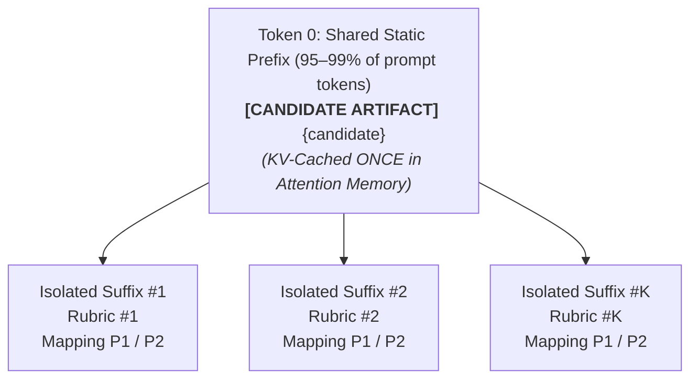

# Production Use Cases & Prompting Best Practices

This document provides role-based setup guides, production patterns, and prompting best practices for **LogitGate**.

---

## Role-Based Setup & Use-Case Guides

LogitGate is designed to fit directly into diverse software engineering and AI workflows across general and non-SDLC domains:

### 1. CI/CD Final Merge Gate vs. Local Developer Inner Loop (Speed vs. Correctness)

In production engineering, **local iteration** and **CI/CD merge gates** have different priorities:
- **CI/CD is your final quality gate**: Correctness and minimizing false passes are paramount. However, you do not need to wait 5–20 seconds per test to generate a 400-token LLM essay when Layer 1 already reached a decisive, non-ambiguous conclusion (`P >= 0.85` pass or `P <= 0.20` fail).
- **Local execution is your fast inner loop**: Developers iterating on code or live agent routers want ~40–90ms GPU feedback (or ~170ms 1-pass triage on CPU-only laptops).

| Dimension | Local Inner-Loop / Live Agent Triage | CI/CD Final Merge Gate (Recommended) |
| :--- | :--- | :--- |
| **Primary Goal** | Fast developer feedback / low-latency routing | **High correctness & minimal false passes** without waiting for LLM essays on clear verdicts |
| **Preset & Debiasing** | `preset="balanced"` on GPU (`~86ms`), or `preset="fast_triage"` (`1-pass`, `~170ms`) on CPU-only laptops | **`preset="balanced"` or `"strict"` (`symmetric_debiasing=True`)** — always cancel prior token bias |
| **Multi-Part Rubrics** | Single rubric or `ChoiceGate` | **Atomic rubrics via `MultiRubricGate`** (weakest-link aggregation, shared-prefix KV-cache reuse, avoids compound dilution) |
| **Layer 2 (`JudgeGate`) Trigger** | Omit `JudgeGate`, or `trigger="on_ambiguous_only"` | **`trigger="on_ambiguous_only"` + `save_on_fail=True`** (0 CoT tokens on decisive pass *or* decisive fail; only invokes `JudgeGate` to adjudicate ambiguous borderline cases) |

```python
from logitgate import ASTGate, LogitGate, JudgeGate, OllamaBackend

# Pure CPU CI Runner configuration (0 GPU, ~3.2 GB RAM for 3B models / ~9.4 GB RAM for gemma4:e4b)
backend = OllamaBackend(
    model="gemma4:e4b",
    options={"num_gpu": 0, "num_thread": 4},
    keep_alive="5m",
)

# Correctness-first CI Merge Gate:
# - Layer 0 catches syntax/import errors in <0.1ms (no LLM call)
# - Layer 1 runs full 2-pass symmetric debiasing (no CoT tokens on clear pass OR clear fail)
# - Layer 2 ONLY fires when Layer 1 is ambiguous (0.20 < P < 0.85)
ci_pipeline = (
    ASTGate(syntax=True, forbidden_imports=["pickle", "subprocess"])
    >> LogitGate(
        rubric="Candidate code must be clean, secure, and handle edge cases.",
        preset="balanced",  # Full 2-pass symmetric log-odds debiasing for CI correctness
        save_on_fail=True,  # Saves .logitgate/failures/*.json on fail for local `logitgate explain`
        backend=backend,
    )
    >> JudgeGate(
        max_tokens=80,
        trigger="on_ambiguous_only",  # Skip generative essays on non-ambiguous verdicts
        backend=backend,
    )
)

candidate_code = "def add_numbers(a: int, b: int) -> int:\n    return a + b\n"
verdict = ci_pipeline.evaluate(candidate_code)
assert verdict.passed, f"CI Gate Failed at {verdict.triggered_layer}: {verdict.reason}"
```

- **Resource Footprint**: Runs in ~2.2–3.2 GB System RAM (`qwen2.5:3b` / `llama3.2:3b`) or ~9.4 GB System RAM (`gemma4:e4b`) with 0 VRAM overhead—fitting comfortably inside a standard 16 GB GitHub Actions (`ubuntu-latest`) VM.
- **Cost Savings**: Runs on standard CPU CI runners without requiring \$0.50–\$2.00/hr GPU instances.

#### Reproducing Non-Deterministic App Failures Locally (`VerdictSnapshot` & `logitgate explain`)

When testing non-deterministic LLM applications in CI using `trigger="on_ambiguous_only"` or `@check`, clear failures fail immediately at Layer 1 without generating a long critique in CI. However, if a developer re-runs their non-deterministic application locally to debug, the LLM may generate a different output, making reproduction difficult.

LogitGate solves this with deterministic **Verdict Snapshots**:
1. When a test fails in CI (with `LOGITGATE_SAVE_FAILURES=1` or `@check(save_snapshot=True)`), LogitGate freezes the exact candidate output, rubric, and telemetry to `.logitgate/failures/fail_<timestamp>_<test>_<id>.json` (and updates `.logitgate/failures/latest.json`).
2. Developers can replay and diagnose the exact failure locally with a single CLI command without re-running their non-deterministic application:

```bash
# Replay and explain the latest failure with full System-2 reasoning
logitgate explain

# Or explain a specific failure snapshot with custom tokens
logitgate explain .logitgate/failures/fail_20261102_150648_test_rag_a1b2c3d4.json --max-tokens 150
```

Programmatic replay and inspection via Python:
```python
from logitgate import VerdictSnapshot

# Load frozen snapshot from CI
snapshot = VerdictSnapshot.load(".logitgate/failures/latest.json")

# Re-run fast Layer-1 logit evaluation on the frozen candidate
replay_verdict = snapshot.replay()

# Or generate a deep Layer-2 diagnostic critique with reasoning enabled
explanation = snapshot.explain(model="qwen2.5-coder:14b", think=True)
print(explanation.reason)
```

---

### 2. RAG & Chatbot Engineers (Hallucination & Groundedness Gating)
Detect hallucinations and verify factual groundedness before streaming an answer to the end user:
```python
from logitgate import ContractGate, LogitGate

retrieved_docs = "LogitGate v0.1.0 requires Python 3.10 or higher and supports Ollama, vLLM, and OpenAI."
generated_response = "LogitGate v0.1.0 supports Python 3.10+ and runs on Ollama, vLLM, and OpenAI."

# Layer 0 ensures reasonable length bounds in 0ms; Layer 1 verifies grounding in ~45ms
rag_gate = (
    ContractGate(min_length=20, max_length=2000)
    >> LogitGate(
        rubric="Does the candidate answer strictly contain only facts asserted in the context snippet?",
        preset="balanced",
    )
)

context_payload = f"[CONTEXT]\n{retrieved_docs}\n\n[ANSWER]\n{generated_response}"
verdict = rag_gate.evaluate(context_payload)

if not verdict.passed:
    # Trigger fallback or retrieve secondary sources
    generated_response = "I cannot verify that from the documentation. Let me connect you with an agent."
```

---

### 3. AI Agent & LangGraph Builders (Fast Guardrails & Routing)
Enforce structured JSON output contracts in **<0.1ms** and perform ~40–90ms conditional routing:
```python
from pydantic import BaseModel
from logitgate import ContractGate, ChoiceGate

class ToolCallPayload(BaseModel):
    tool_name: str
    arguments: dict
    confirm_action: bool

# Layer 0 validates JSON schema in <0.1ms; Layer 1 routes intent in ~40-90ms
agent_router = (
    ContractGate(json_schema=ToolCallPayload)
    >> ChoiceGate(
        question="Select the appropriate downstream handler for this user intent:",
        options={
            "A": "Database Query Execution (read-only safe queries)",
            "B": "Account Management & Authentication changes",
            "C": "General Customer Q&A Response",
        },
    )
)

agent_raw_json = '{"tool_name": "run_sql", "arguments": {"query": "SELECT count(*) FROM users"}, "confirm_action": false}'
verdict = agent_router.evaluate(agent_raw_json)
next_node = {"A": "db_node", "B": "auth_node", "C": "qa_node"}[verdict.choice]
```

---

### 4. QA & Evaluation Engineers (Pytest & Multi-Criteria Rubrics)
Unrecognized Bring-Your-Own (BYO) models automatically run lazy task-separated calibration on their first live `.evaluate()` / `.aevaluate()` call (`LOGITGATE_AUTO_CALIBRATE=1`), while `logitgate calibrate` pre-computes or custom-fits profiles ahead of time for CI warm starts:
```bash
# Pre-calibrate and cache your model's binary + multiclass temperatures offline
logitgate calibrate --backend "ollama://localhost:11434" --model "qwen2.5:14b"
```

```python
from logitgate import MultiRubricGate

rubrics = [
    "Is the customer support reply polite and professional?",
    "Does the assistant enforce multi-factor authentication before updating credentials?",
    "Does the response adhere to the company return and refund policy?",
]

# Atomic multi-rubric gate with weakest-link aggregation:
evaluator = MultiRubricGate(
    rubrics,
    logit_temperature="auto",  # Automatically uses cached calibrated temperature
)

support_transcript = (
    "Customer: Please update my account email and process a refund for order #402.\n"
    "Agent: I would be happy to help! Before I can update your email, please complete "
    "the 2FA verification sent to your phone. Your refund for order #402 has been initiated "
    "per our 30-day return policy."
)

# Evaluates all 3 rubrics in a single batch reusing the shared prompt prefix in KV-cache
verdict = evaluator(support_transcript)
print(f"Overall Passed: {verdict.passed} | Reason: {verdict.reason}")

# Or inspect individual per-rubric verdicts:
for r, v in zip(rubrics, evaluator.evaluate_each(support_transcript)):
    print(f"[{'PASS' if v.passed else 'FAIL'}] P={v.probability:.2f} | {r}")
```

---

## Best Practices: Prompting, Context Length, & Model Sizing

### 1. Document Context Length & When to Chunk
- **Zero-Chunking Sweet Spot (Up to 16,000–32,000 Tokens)**: As shown in our needle-in-a-haystack benchmarks in [`benchmarks.md`](benchmarks.md), modern causal transformers (`gemma4`, `qwen2.5`) maintain strong probability separation ($\Delta P > 0.993$) up to **16,000+ tokens** without manual chunking, and sliding-window/MoE architectures scale cleanly to **32k–64k tokens** in VRAM.
- **When to Chunk (50,000+ Token Codebases or Books)**: If a document exceeds your model's configured context window (`num_ctx`) or exceeds 32k–50k tokens on a dense attention model, split the document into logical sections or files and call `gate.evaluate(chunk)` on each section independently.
- **Multi-Rubric KV Sharing (`evaluate_batch`)**: `gate.evaluate_batch(candidate, rubrics)` is designed for evaluating **multiple atomic rubrics against a single candidate artifact** (sharing the `[CANDIDATE ARTIFACT]` root prefix across all $K$ rubrics in the KV-cache), rather than evaluating multiple documents against one rubric.

### 2. Best Practice vs. Anti-Pattern: Candidate-Prefix Isolated Batching (`evaluate_batch`)

When evaluating complex systems, users often wonder whether to write one large prompt or multiple smaller ones, and how to execute them efficiently:

#### The Anti-Patterns
1. **Monolithic Compound Rubrics**: Cramming multiple orthogonal requirements into a single giant rubric prompt (e.g. *"Ensure valid syntax, Google docstrings, full type hints, no mutable defaults, and SQL safety"*). When a candidate complies with 4 of 5 requirements but subtly violates 1 (e.g. an omitted return type annotation on a typed function), first-token logits experience signal dilution, resulting in $P \approx 0.82–0.89$ which can either slip through as an uninspected false pass or trigger inconsistent escalation.
2. **Monolithic Prompt-Prefix Concatenation**: Concatenating all $K$ rubrics together into a single shared prompt block (`[EVALUATION RUBRICS]\nRubric #1...\nRubric #K...`) preceding the candidate. When evaluating 50 to 500 rubrics, this injects thousands of rubric tokens before the candidate artifact, blowing the context window on lightweight models and causing severe **cross-rubric attention contamination** (attention heads judging Rubric #1 become distracted by text in Rubric #47).

#### The Best Practice: Candidate-Prefix Isolated Batching
LogitGate solves both problems via **Candidate-Prefix Isolated Batching** (`compile_batch_binary_prompt(..., query_first=False)`):



- **Candidate Anchored at Token 0**: The candidate artifact (500 to 10,000+ tokens) forms the shared static root prefix across all $K$ rubrics and both forward/reverse debiasing passes ($2K$ forward passes total).
- **100% Suffix Rubric Isolation**: Each rubric is appended in complete isolation at the very end of the prompt. It never sees or attends to any other rubric.
- **Zero Cross-Rubric Attention Contamination**: Because causal attention is strictly unidirectional, the candidate context cannot attend forward to future tokens. The candidate representation is computed and KV-cached once. Each isolated rubric query suffix only attends back to the candidate document.
- **Zero Context Bloat & Linear Scalability**: Evaluating 2 rubrics or 500 rubrics requires the exact same context window length ($|\text{candidate}| + |\text{rubric}_k| + |\text{mapping}|$).
- **Near-Instant Execution**: Across all $2K$ forward passes, inference engines (vLLM, Ollama, llama.cpp) hit the prefix cache for 95–99% of total tokens, dropping per-rubric warm latency to ~20–40ms.

### 3. Defense-in-Depth: Combining Temperature Calibration with Strict Operational Thresholds

A common question in production gating is whether temperature calibration makes strict confidence thresholds redundant, or vice versa. In LogitGate, they serve two distinct, complementary functions:

1. **Temperature Calibration ($T$) Repairs Intrinsic Model Distortion**:
   Different model families have distinct confidence distributions. An uncalibrated model might output a raw probability of $0.93$ when its actual empirical precision on that task is only $75\%$, or conversely remain underconfident ($P=0.79$) on unambiguous passes. Post-hoc temperature scaling ($\bar{L} / T$) rescales the symmetric log-odds so that a reported $P=0.85$ mathematically corresponds to an empirical 85% probability of correctness. Calibration normalizes the meaning of confidence across diverse models (`gemma4:e4b`, `qwen2.5:14b`, `llama3`).
2. **Operational Thresholds (`pass_threshold`, `fail_threshold`) Enforce Risk Tolerance**:
   Operational thresholds govern the system's escalation policy (the width of the ambiguity/escalation band):
   - **`preset="fast_triage"` (`pass_threshold=0.80`, `fail_threshold=0.20`)**: Maximizes short-circuiting speed for local developer loops, agent routing, and high-throughput classification.
   - **`preset="strict"` (`pass_threshold=0.90`, `fail_threshold=0.25`)**: Enforces defense-in-depth for mission-critical CI merge gates, financial transactions, or automated security reviews. Any candidate with less than 90% calibrated confidence is classified as `AMBIGUOUS` and escalated to Layer 2 (`JudgeGate`) for full step-by-step System-2 diagnostic critique.

**Conclusion**: Temperature calibration ensures that $P=0.90$ actually means 90% certainty; strict operational thresholds ensure that your pipeline never bypasses System-2 reasoning on anything less than 90% certainty.

### 4. Escalation Mechanics: How Symmetric Log-Odds Handle Model Uncertainty
- **Decisive Signal**: When a model is confident that an artifact passes, both forward ($L_1 = s + b$) and reverse ($L_2 = s - b$) log-odds are positive, yielding calibrated probability $P \ge 0.85$ (fast-path pass, no Layer 2 critique).
- **Decisive Failure**: When an artifact clearly violates the rubric, both forward and reverse log-odds are negative, yielding $P \le 0.20$ (decisive failure).
- **Ambiguity & Escalation**: When small models (e.g. 3B–4B) or complex edge cases yield borderline log-odds (between 0.20 and 0.85), LogitGate flags the item as `AMBIGUOUS` and triggers Layer 2 (`JudgeGate`) to generate an autoregressive critique.
